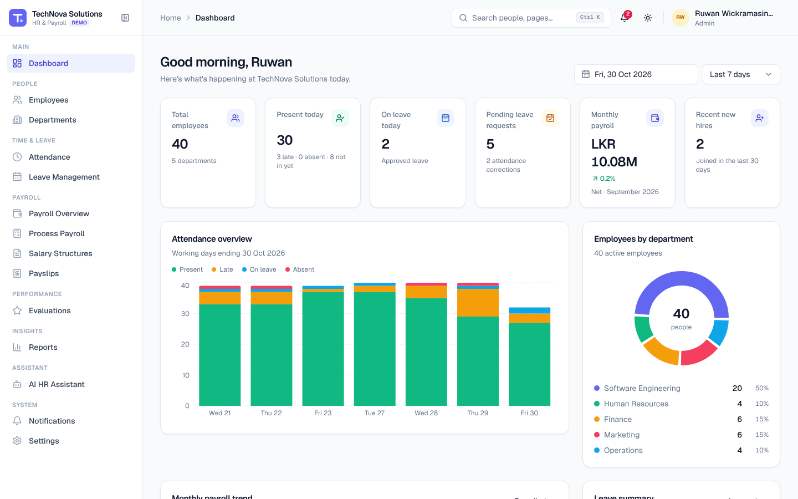

# TechNova HR & Payroll — Frontend Prototype

A modern, responsive HR & Payroll management system for a Sri Lankan IT company (*TechNova Solutions (Pvt) Ltd.*), built as a **frontend-only prototype** with realistic, interconnected mock data, a simulated AI HR assistant, a Playwright test suite, and automatically generated screenshots, walkthrough videos and user guides.



> **Prototype scope.** There is no backend, database, real authentication, bank integration or AI API. Data is generated deterministically in the browser and persisted to `localStorage`. Payroll values (LKR, EPF, ETF, APIT) are clearly labelled illustrative examples — not a compliance engine.

## Quick start

```bash
npm install
npm run dev            # http://localhost:3000
```

Sign in with any demo account (password **`demo1234`**) — click an account card on the login page.

| Role | Demo user | Access |
| --- | --- | --- |
| Admin | Ruwan Wickramasinghe | Everything, including organization settings |
| HR Manager | Nadeesha Fernando | Employees, departments, attendance, leave approvals, performance, HR reports |
| Payroll Manager | Chamara Silva | Payroll processing, salary structures, payslips, payroll reports |
| Team Lead | Kasun Bandara | Team attendance, leave approvals and performance |
| Employee | Tharushi Perera | Self-service: dashboard, attendance, leave, payslips, profile, AI assistant |

Switch roles any time from the profile menu (top-right) or **Settings → Demo**, where you can also **reset the demo data**.

Full instructions: [docs/QUICK_START.md](docs/QUICK_START.md).

## Documentation

| Document | Contents |
| --- | --- |
| [Quick Start](docs/QUICK_START.md) | Running the app, demo login, roles, reset, themes, commands |
| [User Guide](docs/USER_GUIDE.md) | Every workflow step by step with screenshots and videos ([HTML](docs/user-guide.html) · [PDF](docs/USER_GUIDE.pdf)) |
| [Admin Guide](docs/ADMIN_GUIDE.md) | Employees, departments, leave, attendance, payroll, performance, settings |
| [Employee Guide](docs/EMPLOYEE_GUIDE.md) | Self-service for employees |
| [Video Guide](docs/VIDEO_GUIDE.md) | Eight recorded walkthroughs (`docs/videos/`, WebM + MP4) |
| [docs/index.html](docs/index.html) | Browsable HTML version of all guides |

Screenshots (102, real Playwright captures) live in `docs/screenshots/{desktop,tablet,mobile,dark-mode,workflows}`.

## Features

- **Dashboards** for every role, all figures derived from live data: KPI cards (linked), attendance / department / payroll / leave charts with tooltips, date + range filters, pending approvals, activity feed, birthdays, anniversaries, quick actions and AI shortcuts.
- **Employee management:** searchable, filterable, sortable, paginated directory with CSV export; multi-section add/edit form (zod validation, unsaved-changes guard, photo upload, skills); profile with Overview / Employment / Attendance / Leave / Payroll / Performance tabs; archive and restore.
- **Departments & designations:** CRUD with validation and archive protection when in use.
- **Attendance:** clock in/out with late detection and worked hours, daily overview with department chart, monthly calendar, history, correction requests and approvals that rewrite the record.
- **Leave:** balances, apply form with live working-day calculation and balance validation (weekends, holidays, overlaps, max consecutive days), half days, attachments, approvals/rejections with comments, cancellation, team calendar, policies.
- **Payroll:** dashboard and trend, salary structures with live preview, deterministic calculation engine (earnings, overtime, bonus, EPF 8/12%, ETF 3%, APIT brackets, loans, unpaid leave, pro-rating), warnings, Draft → Pending Approval → Approved → Processed workflow with confirmation and double-processing protection, history with CSV registers, printable payslips with client-side PDF download, payroll settings.
- **Performance:** 7-criteria 1–5 evaluations (draft/submit), overview with distribution and department averages, details with history, goals, self evaluation.
- **AI HR Assistant (demo simulation):** chat with typing indicator, suggested prompts, result cards, history and clearing; answers from live records for employees, HR and payroll roles; permission-aware; applies for leave after an explicit confirmation step.
- **Reports:** employee, attendance, leave and payroll reports with date/department/employee/search filters, charts, CSV, PDF and print.
- **Notifications** generated by real actions, with unread count, mark read/unread and mark all.
- **Settings:** organization (with logo), departments, designations, leave policies and working-day rules, payroll settings, preferences (theme, notification types), demo management.
- **Design system:** one token-based theme (indigo primary, the specified light/dark palettes), light / dark / system themes without flash, theme-aware charts, dialogs, dropdowns, date pickers and toasts; fully responsive from 390 px phones (drawer navigation, bottom-sheet dialogs) through tablets (icon rail) to desktops (collapsible sidebar); keyboard-accessible dialogs with focus return.

## Tech stack

Next.js 16 (App Router, Turbopack) · React 19 · TypeScript (strict) · Tailwind CSS 4 · Radix UI primitives in shadcn/ui-style components · lucide-react · React Hook Form + Zod · Sonner · Recharts · date-fns · TanStack Table · next-themes · Motion · Zustand (+ immer, persisted to localStorage with a versioned schema) · jsPDF + jspdf-autotable · cmdk · react-day-picker · Playwright.

TypeScript is pinned to 5.9 and TanStack Table to v8, react-day-picker to v9 and Motion to v12 for API stability; everything else uses the current stable releases.

## Scripts

| Command | Description |
| --- | --- |
| `npm run dev` | Development server on port 3000 |
| `npm run build` · `npm run start` | Production build and server |
| `npm run typecheck` | `tsc --noEmit` (strict) |
| `npm run seed` | Generate the demo dataset in Node, run integrity checks, print a summary |
| `npm run test:e2e` | Playwright end-to-end suite (desktop `e2e` + `mobile` projects) |
| `npm run test:e2e:ui` | Playwright UI mode |
| `npm run test:e2e:report` | Open the last HTML test report |
| `npm run docs:screenshots` | Capture all documentation screenshots |
| `npm run docs:videos` | Record the eight walkthrough videos |
| `npm run docs:generate` | Screenshots + videos + MP4 conversion + HTML/PDF guides + verification |
| `npm run docs:verify` | Verify that every guide, screenshot and video reference exists |

Playwright starts the app itself (`npm run build && npm run start`) unless a server is already running on port 3000; set `PW_DEV=1` to test against `next dev`. Install the browser once with `npx playwright install chromium`.

## Testing

`tests/e2e/` contains 35 tests grouped by module — authentication & roles, employees & departments, attendance, leave, payroll & reports, performance, AI assistant, UI (themes, dialogs, date picker, accessible names, notifications, demo reset) and responsive layout (mobile drawer, no horizontal overflow on 35 pages at 390 px, dialogs fit the screen).

Tests are deterministic: each runs in a fresh browser context (fresh seed data), with the browser clock frozen at **Fri 30 Oct 2026 10:30, Asia/Colombo**, and fails on any unexpected console error. Failure screenshots, videos and traces are retained.

`tests/documentation/` holds the separate screenshot and walkthrough capture suites (`docs` project).

## Project structure

```
src/
  app/                    Next.js routes — login, and (app)/… for every module
  components/
    ui/                   design-system primitives (button, inputs, overlays, table, calendar…)
    forms/                field wrapper, date/range/time pickers, searchable select, currency, upload
    layout/               AppLayout, AppSidebar, MobileSidebar, AppHeader, breadcrumbs, search, theme, menus
    shared/               PageHeader, KPI cards, empty/loading states, confirm dialog, timeline…
    tables/ charts/       TanStack data table, theme-aware chart helpers
  features/               module UIs (employees, attendance, leave, payroll, performance, reports,
                          ai-assistant, dashboard, organization, notifications, settings)
  data/seed-data/         company catalog + deterministic generator (40 employees, 30 days attendance…)
  store/hr-store.ts       single persisted Zustand store with all mutations
  services/mock-api.ts    simulated latency wrapper
  lib/                    payroll engine, leave rules, dates, permissions, PDF, utils
  hooks/ types/
tests/e2e/ tests/documentation/ tests/support/
scripts/                  seed-demo-data.ts, generate-documentation.ts, verify-documentation.ts
docs/                     guides, screenshots, videos, HTML and PDF output
```

## Mock data

Generated deterministically (fixed PRNG seed) relative to the day it is created: 1 company, 5 departments, 17 designations, 40 employees, 40 salary structures, ~840 attendance records over 30 days, 32 leave requests, 6 processed payroll months (240+ payslips), 32 evaluations, 26 goals, 22+ notifications and 5 demo accounts. `npm run seed` validates referential integrity and determinism. The store schema is versioned; a version change reseeds automatically.

## Limitations

- Frontend only: no server, real authentication, email delivery, bank payments or multi-user sync. Data lives in one browser's `localStorage`.
- Payroll, EPF/ETF and APIT figures are illustrative and not legally current; the holiday calendar is illustrative.
- The AI assistant is a deterministic rule-based simulation that understands a defined set of HR questions; it is not a language model.
- Sample data is anchored to the date it was generated — reset the demo data on later days to bring "today" back in line.
- Both Admin and Payroll Manager may approve payroll in the demo (a real system would separate duties).
