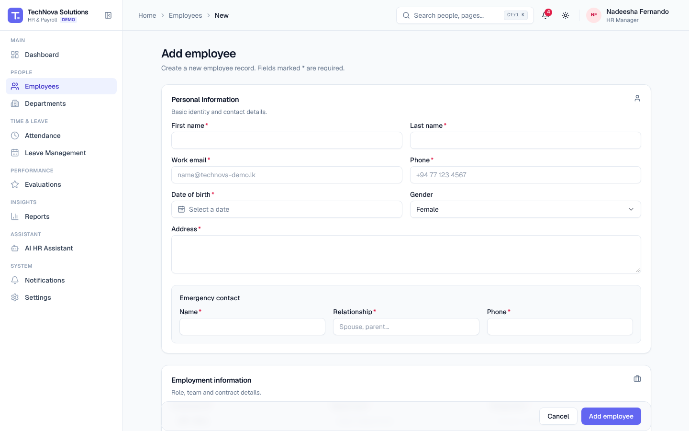
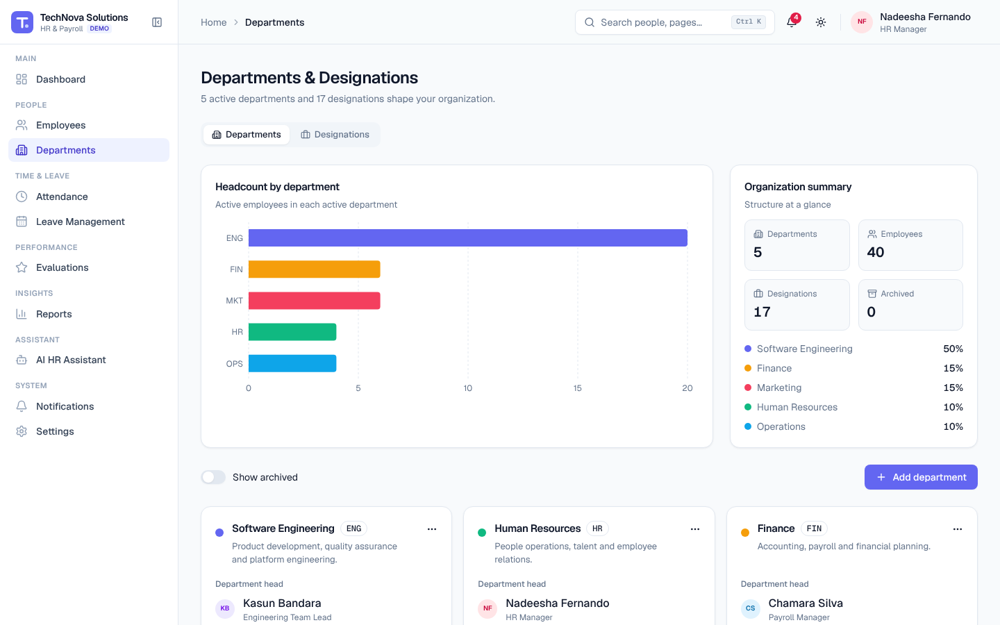
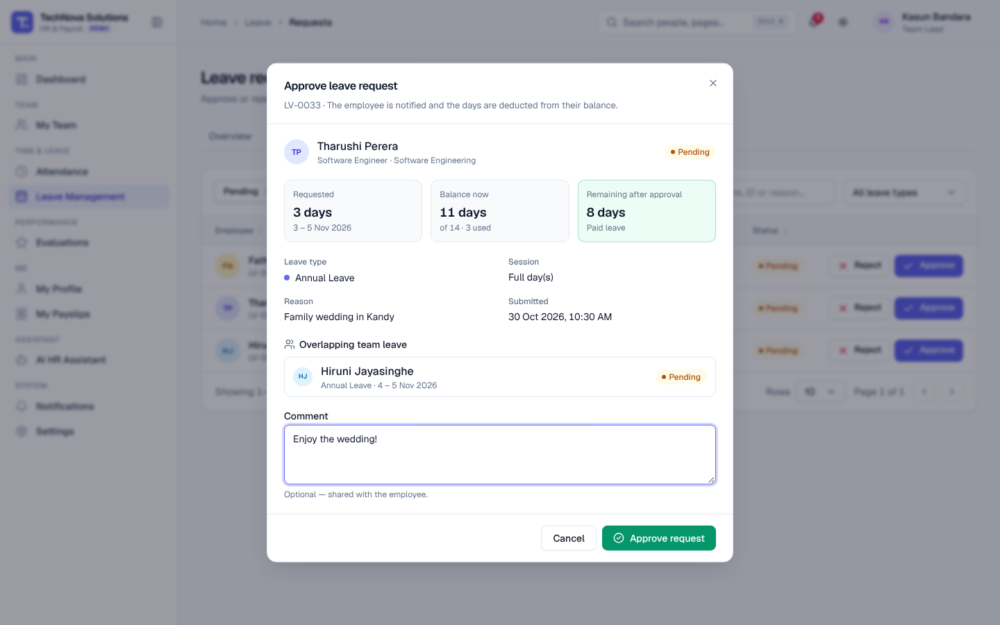
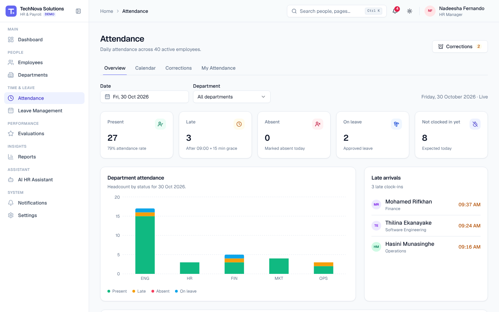
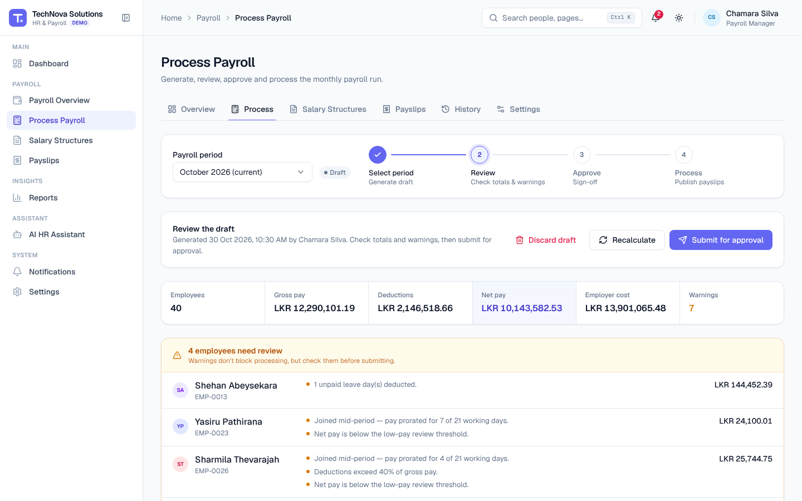
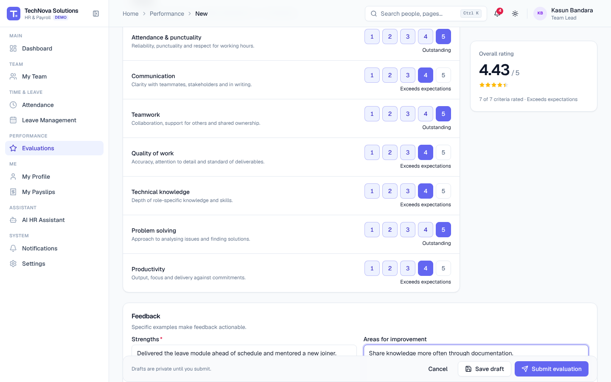
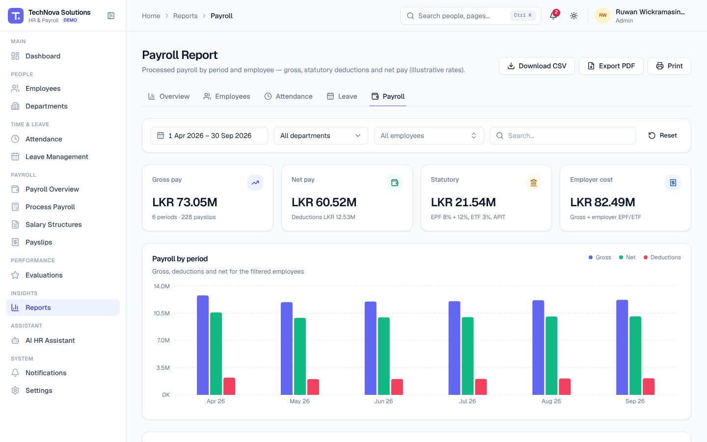
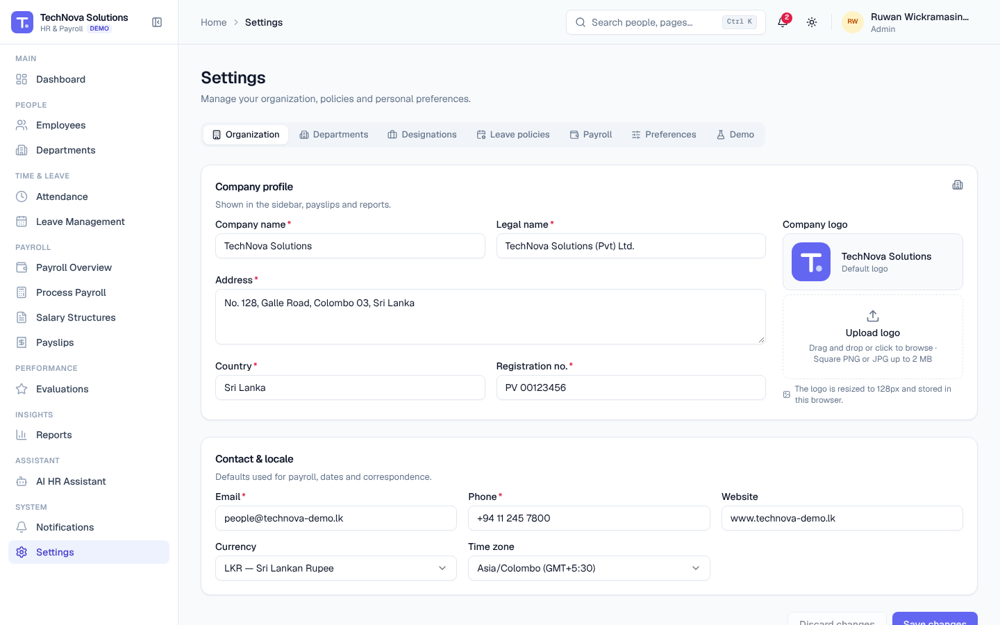

# Admin Guide

For **Admin**, **HR Manager**, **Payroll Manager** and **Team Lead** users. It explains how to run the HR and payroll operations of TechNova Solutions in this prototype. For every screen in detail, see the [User Guide](USER_GUIDE.md).

| Task | Admin | HR Manager | Payroll Manager | Team Lead |
| --- | :-: | :-: | :-: | :-: |
| Manage employees, departments, designations | ✓ | ✓ | – | View team |
| Attendance overview, calendar, corrections | ✓ | ✓ | – | Team |
| Leave approvals and policies | ✓ | ✓ | – | Team approvals |
| Salary structures, payroll processing, payroll settings | ✓ | – | ✓ | – |
| Performance evaluations | ✓ | ✓ | – | Team |
| Reports | All | HR reports | Payroll report | – |
| Organization settings | ✓ | – | – | – |

Every role also has the employee self-service pages for themselves (My Profile, My Leave, My Payslips, My Attendance, My Performance) — see the [Employee Guide](EMPLOYEE_GUIDE.md).

---

## 1. Employee management

**Navigation:** Sidebar → Employees

### Add a new hire
1. Click **Add employee**.
2. Complete **Personal information** (name, email, phone, date of birth, address, emergency contact).
3. Complete **Employment information** — the ID is generated for you; choose department, designation, reporting manager, joining date, type and status (new hires usually start on *Probation*).
4. Enter **Salary information** (basic salary and allowances).
5. Add skills, notes and a photo if you have them, then click **Add employee**.

The new hire immediately appears in the directory, payroll (eligible from their joining date — pay is pro-rated for a mid-month start), attendance and leave, and Admin, Payroll and the manager are notified.

### Keep records current
- **Edit:** row actions (⋯) → **Edit**, change fields, **Save changes**.
- **Archive a leaver:** row actions → **Archive** → **Archive employee**. They disappear from the directory and future payroll runs; history is kept.
- **Restore:** status filter → **Archived** → row actions → **Restore**.
- **Export:** **Export CSV** downloads the filtered directory.

Video: [02 — Employee management](videos/02-employee-management.webm)

## 2. Department setup

**Navigation:** Sidebar → Departments (or Settings → Departments / Designations)

1. **Add department** → name, unique 2–5 letter code, description, department head, colour.
2. Switch to **Designations** → **Add designation** → title, department, level.
3. Archive departments or designations that are no longer used. Anything still assigned to active employees can't be archived — move those employees first.

## 3. Leave management

**Navigation:** Sidebar → Leave Management

- **Overview** shows pending requests, who is out today, approved days this month and upcoming leave.
- **Requests** is your approval queue. Click **Approve** or **Reject**, review the employee's remaining balance and overlapping team leave, add a comment (required for rejection) and confirm. Team Leads only see their direct reports.
- **Calendar** shows approved and pending leave, weekends and public holidays by month (filter by department).
- **Policies** shows allocations and rules. Change them in **Settings → Leave policies**: allocation days, notice days, maximum consecutive days, active types, working weekdays, workday hours, grace minutes and half-day hours.

Video: [04 — Leave management](videos/04-leave-management.webm)

## 4. Attendance management

**Navigation:** Sidebar → Attendance

- **Overview:** pick a date to see Present / Late / Absent / On leave / Not clocked in, a department chart and a daily table you can filter and search.
- **Calendar:** one employee's month, with clock times and a monthly summary.
- **Corrections:** approve or reject correction requests. Approving rewrites that day's attendance record (and recalculates Late/Present). A comment is required to reject.

Late threshold = workday start (09:00) + grace minutes (15). Unexplained absences are flagged in payroll warnings when an employee has three or more in a month.

Video: [03 — Attendance management](videos/03-attendance-management.webm)

## 5. Payroll processing

**Navigation:** Sidebar → Process Payroll (Admin, Payroll Manager)

### Before you run payroll
1. Review **Salary Structures** — click **Edit salary for EMP-…** to change basic pay, allowances, bonus, overtime hours, loans or other deductions. The live preview shows the effect on this month's net pay.
2. Check **Payroll → Settings** (pay day, illustrative EPF 8% / 12%, ETF 3%, APIT brackets, overtime multiplier, low-pay threshold).

### Monthly run
1. Select the **Payroll period** and click **Generate payroll**.
2. Review totals and every item in the **warnings** panel (pro-rated joiners, unpaid leave, absences, high deductions, low net pay). Click any row for its full breakdown.
3. Fix data if needed and click **Recalculate**.
4. **Submit for approval** → **Approve payroll** (confirm) → **Process payroll** (confirm).
5. Click **View payslips** to check the generated payslips.

Once processed, a period is locked — it can't be processed twice and its payslips never change. **History** keeps every run with per-run CSV registers.

Video: [05 — Payroll management](videos/05-payroll-management.webm)

> The payroll engine is deterministic TypeScript (`src/lib/payroll.ts`). EPF, ETF and APIT values are illustrative examples for Sri Lanka and are **not** a compliance engine.

## 6. Performance evaluations

**Navigation:** Sidebar → Evaluations

1. Check **Due for review** for people without a review in the current cycle and click **Start review**.
2. Rate seven criteria (1–5), write strengths, areas for improvement and comments.
3. **Save draft** or **Submit evaluation**. Submitted reviews notify the employee and HR.
4. Use the overview's rating distribution and department averages to compare teams.

Video: [06 — Performance management](videos/06-performance-management.webm)

## 7. Reports

**Navigation:** Sidebar → Reports

Employee, Attendance, Leave and Payroll reports can be filtered by date range, department, employee and search text. Each has **Download CSV**, **Export PDF** and **Print**.

## 8. Settings

**Navigation:** Sidebar → Settings

| Tab | Who | What |
| --- | --- | --- |
| Organization | Admin | Company name, legal name, address, country, currency, time zone, contacts, logo |
| Departments / Designations | Admin, HR | Same managers as the Departments page |
| Leave policies | Admin, HR | Leave type allocations and rules, working-day rules |
| Payroll | Admin, Payroll | Pay day, statutory example rates, APIT brackets |
| Preferences | Everyone | Theme, notification preferences |
| Demo | Everyone | Switch demo role, reset demo data, restore sample records, data statistics |

## 9. Using the AI assistant as a manager

HR Managers can ask *"How many employees are absent today?"*, *"Show pending leave requests."*, *"Which employees joined this month?"*, *"Summarize employee attendance."* or *"How many employees work in IT?"*. Payroll Managers can ask about this month's total payroll, calculation warnings, pending payroll records and salary expenses. Answers are limited to what your role may see.

Video: [07 — AI HR Assistant](videos/07-ai-assistant.webm)
