# Employee Guide

Everything an employee can do in TechNova HR without contacting HR. Sign in with the **Employee** demo account (Tharushi Perera, password `demo1234`) to follow along.

Video: [08 — Employee self-service](videos/08-employee-self-service.webm)

---

## 1. Your dashboard

**Navigation:** Sidebar → My Dashboard

Your dashboard greets you and shows today's clock-in status, your leave balance, your latest payslip, recent attendance, pending requests, upcoming public holidays, your goals and quick actions (Apply leave, View payslip, My performance, Ask AI assistant).

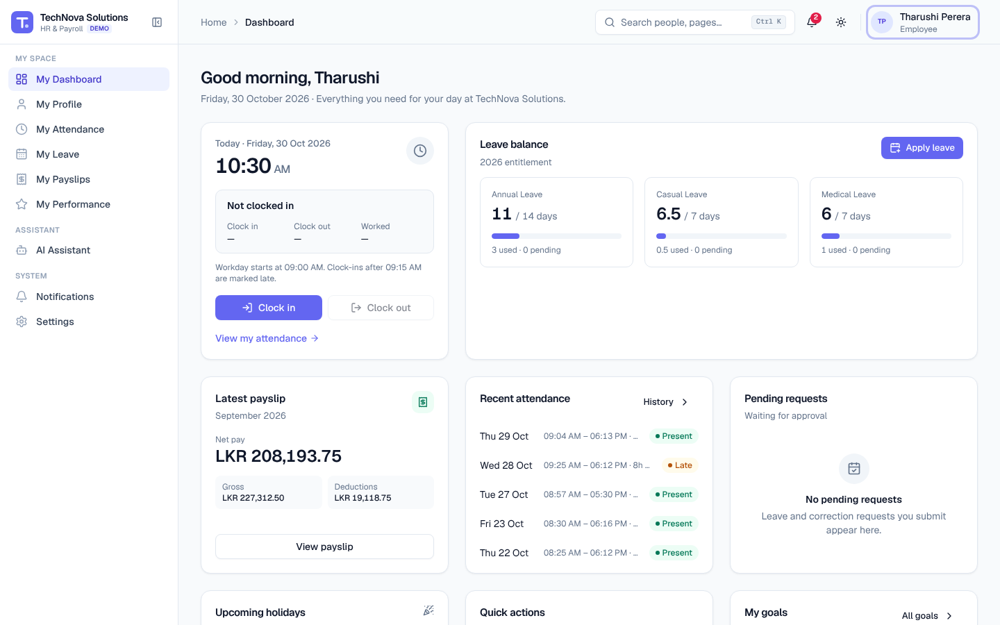

## 2. Clock in and clock out

1. On the dashboard or **My Attendance**, click **Clock in** when you start work. The time is recorded in your local time zone and your status changes to *Working since …*.
2. Click **Clock out** when you finish. You'll see how long you worked, e.g. *Completed — 7h 35m*.

If you clock in after **09:15** the day is marked **Late**. Clock-in isn't available on weekends, public holidays or days you're on approved leave.

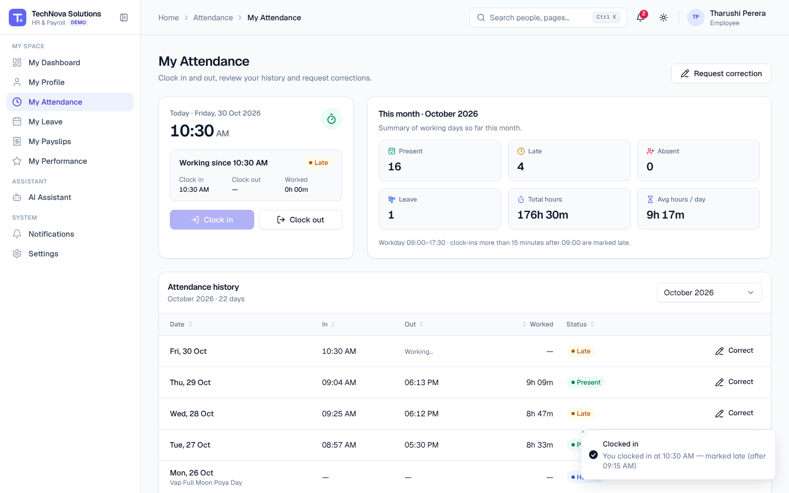

### Fix a mistake
Forgot to clock out? On **My Attendance**, click **Request correction** (or **Correct** on a history row), choose the date, the corrected times and a reason, then **Submit request**. Your manager reviews it and you're notified of the decision.

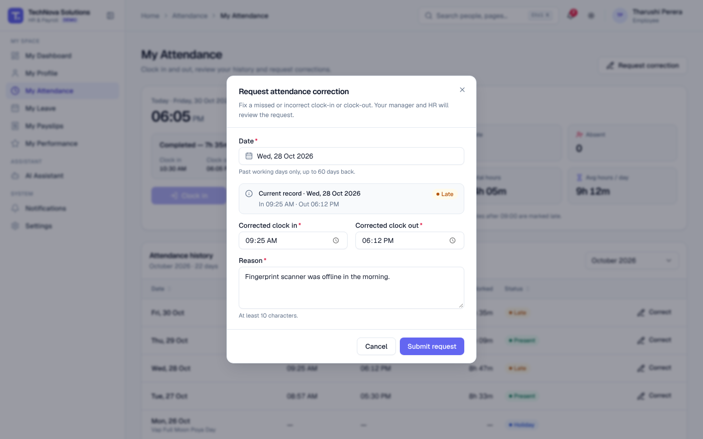

Video: [03 — Attendance management](videos/03-attendance-management.webm)

## 3. Check your leave balance

**Navigation:** Sidebar → My Leave

Each card shows how many days you have available out of your yearly allocation, and how many are used or pending. Pending requests are already deducted so you never over-book.

| Leave type | Days per year (illustrative) |
| --- | --- |
| Annual Leave | 14 |
| Casual Leave | 7 |
| Medical Leave | 7 |
| Unpaid Leave | No limit (deducted from pay) |

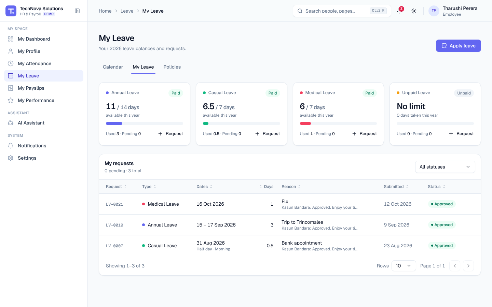

## 4. Apply for leave

1. Go to **My Leave** and click **Apply leave**.
2. Choose the **Leave type**.
3. Pick the **Start date** and **End date**. Weekends and public holidays are skipped automatically.
4. For a half day, turn on **Half day** and choose Morning or Afternoon.
5. Write a short **Reason** and attach a document if needed (e.g. a medical certificate).
6. Check the **Summary** — working days, balance before and after.
7. Click **Submit request**.

Your request appears as **Pending**, and your manager is notified. When they approve or reject it you get a notification and the status changes under **My requests**. You can **Cancel** a pending or upcoming request at any time.

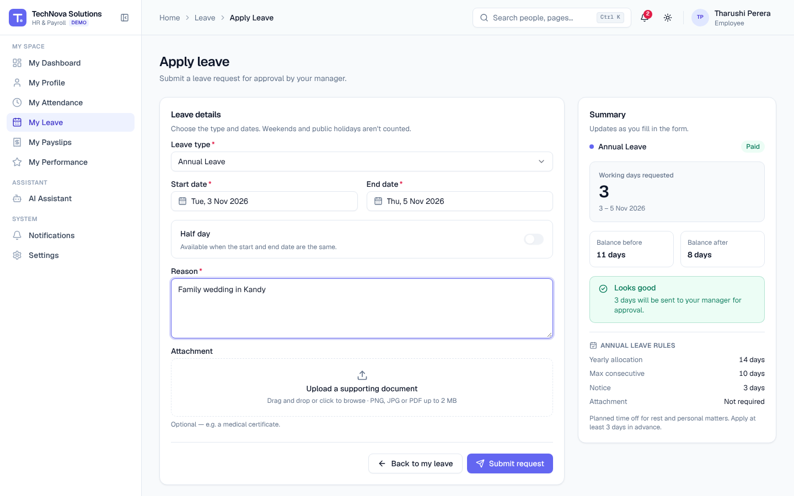

Video: [04 — Leave management](videos/04-leave-management.webm)

## 5. View your payslips

**Navigation:** Sidebar → My Payslips

Your latest payslip is highlighted at the top. Click **Open latest payslip** (or **View** on any month) to see earnings, deductions (EPF, APIT, loans) and your net pay. Use **Download PDF** to save it or **Print** for a paper copy.

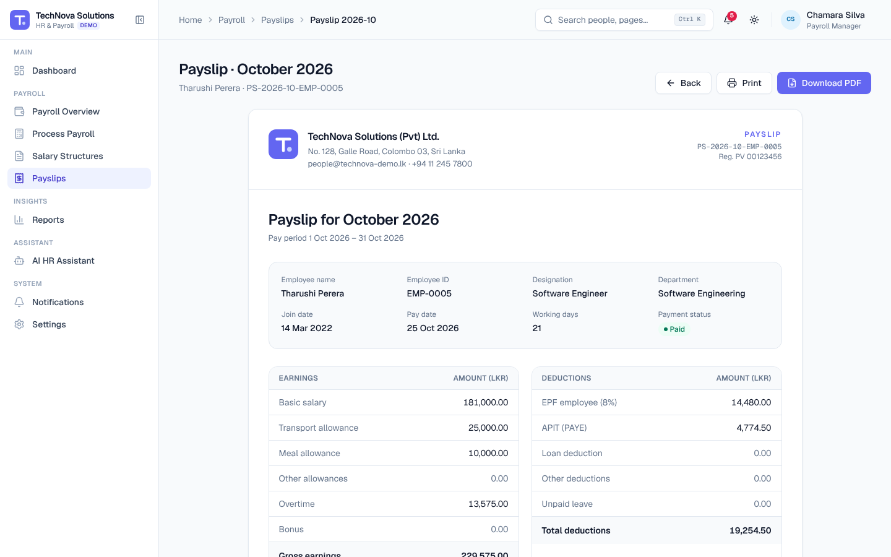

## 6. View your performance

**Navigation:** Sidebar → My Performance

See your latest rating, every submitted review and your goals. Update a goal's progress and click **Update**, add a new goal with **Add goal**, or click **Start self evaluation** to rate yourself.

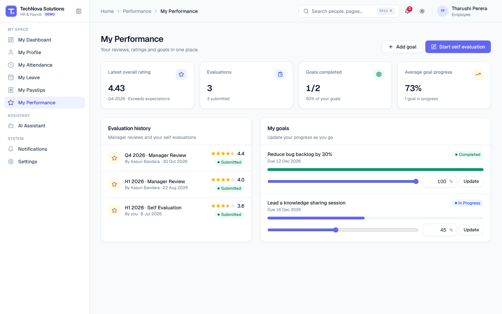

## 7. Update your profile

**Navigation:** Sidebar → My Profile → **Update contact details**

Change your phone number, address, emergency contact and photo, then click **Save details**. Your employment and salary details are maintained by HR and Payroll.

## 8. Use the AI assistant

**Navigation:** Sidebar → AI Assistant

Ask in plain English:

- *How many leave days do I have?*
- *Show my attendance this month.*
- *What is my latest salary?* / *Show my payslip.*
- *What is the annual leave policy?*
- *Can I apply for leave tomorrow?*
- *Apply for annual leave next Monday for 2 days*

When you ask it to apply for leave, the assistant checks your balance and shows the request for you to review. Nothing is submitted until you click **Confirm and submit**.

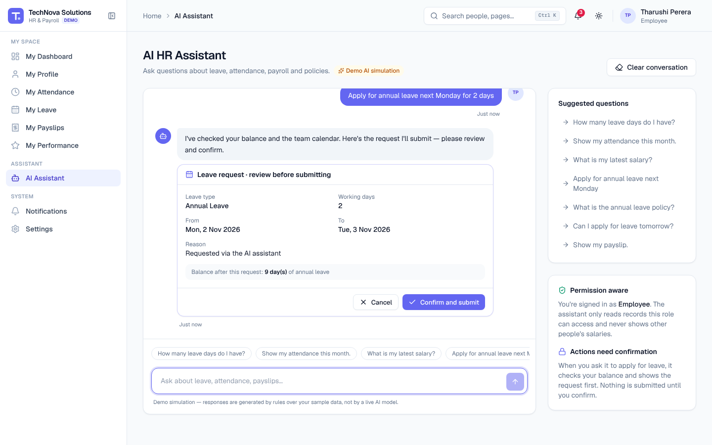

Video: [07 — AI HR Assistant](videos/07-ai-assistant.webm)

> The assistant is a demo simulation that answers from your own HR records. It never shows other people's information.

## 9. On your phone

Everything works on a phone: tap ☰ to open the menu, and forms and dialogs adapt to the screen.

| Dashboard | Apply leave | Payslip |
| --- | --- | --- |
| 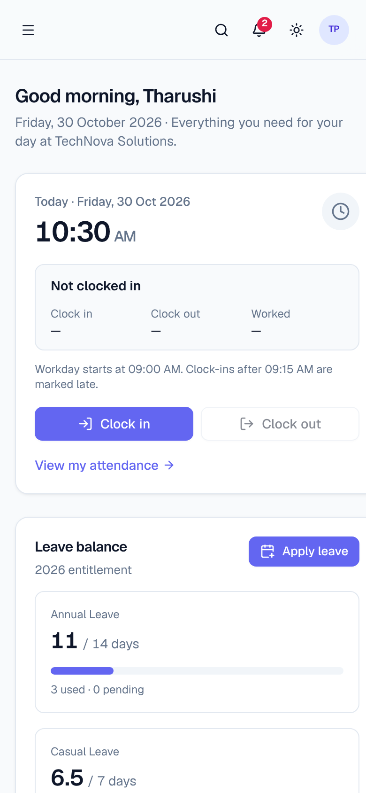 | 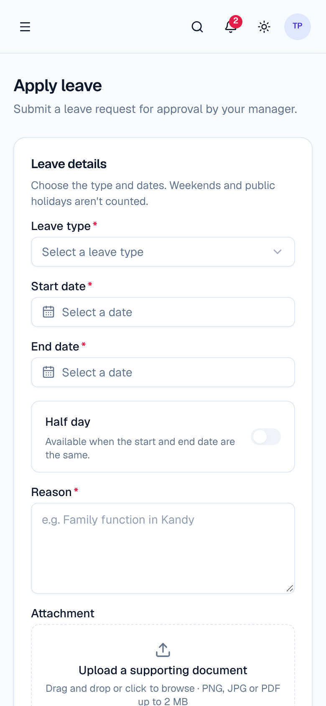 | 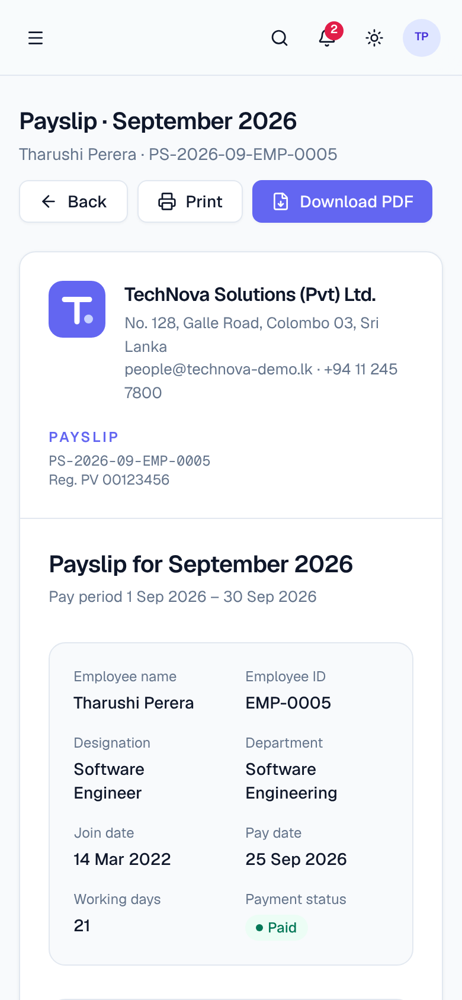 |
