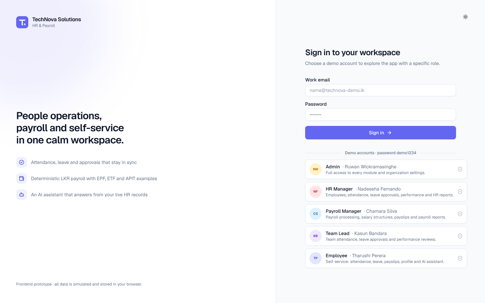
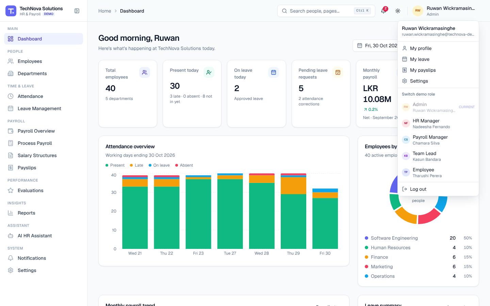

# Quick Start

TechNova HR & Payroll is a **frontend-only prototype**. There is no backend: all data is realistic sample data generated in your browser and saved to `localStorage`. Nothing you do affects real people, payments or accounts.

## 1. Start the application

Requirements: **Node.js 20.9 or newer** (tested with Node 22) and npm.

```bash
npm install          # install dependencies
npm run dev          # development server on http://localhost:3000
```

For a production build:

```bash
npm run build
npm run start        # serves the build on http://localhost:3000
```

Open <http://localhost:3000>. You are redirected to the sign-in page.

## 2. Sign in with a demo account



1. Click one of the five **Demo accounts** below the form. The email and password are filled in for you.
2. Click **Sign in**.

All demo accounts use the password **`demo1234`**. You can also type an account's email and password manually.

| Role | Demo user | What the role can do |
| --- | --- | --- |
| **Admin** | Ruwan Wickramasinghe (COO) | Every module, organization settings, payroll and all reports |
| **HR Manager** | Nadeesha Fernando | Employees, departments, attendance, leave approvals, performance, HR reports |
| **Payroll Manager** | Chamara Silva | Payroll processing, salary structures, payslips, payroll reports |
| **Team Lead** | Kasun Bandara | Team attendance, team leave approvals, team performance reviews |
| **Employee** | Tharushi Perera (reports to Kasun) | Personal dashboard, own attendance, leave, payslips, profile, AI assistant |

The sidebar only shows modules the current role is allowed to open, and private salary information is hidden from roles that may not see it.

## 3. Switch roles without signing out

Open the **profile menu** (your name in the top-right corner) and pick a role under **Switch demo role**. You land on that role's dashboard. You can also switch from **Settings → Demo**.



## 4. Switch between light, dark and system themes

- Click the **sun / moon** button in the header and choose **Light**, **Dark** or **System**, or
- Go to **Settings → Preferences** and pick a theme card.

Your choice is remembered in this browser.

## 5. Reset the demo data

Go to **Settings → Demo** and click **Reset demo data**, then **Reset data** to confirm. Every record (employees, attendance, leave, payroll, evaluations, notifications) is regenerated for **today's date** and you stay signed in. **Restore sample records** only un-archives sample employees, departments and designations without touching anything else.

> The sample data is dated relative to the day it was generated. If you come back on a later day, the dashboard shows a notice with a link to reset the data so "today" lines up again.

## 6. Useful commands

| Command | What it does |
| --- | --- |
| `npm run dev` | Development server (http://localhost:3000) |
| `npm run build` / `npm run start` | Production build and server |
| `npm run typecheck` | TypeScript strict type check |
| `npm run seed` | Generates the demo dataset in Node, runs integrity checks and prints a summary |
| `npm run test:e2e` | Playwright end-to-end tests (desktop + mobile) |
| `npm run test:e2e:ui` | Playwright UI mode |
| `npm run docs:screenshots` | Captures documentation screenshots into `docs/screenshots/` |
| `npm run docs:videos` | Records walkthrough videos into `docs/videos/` |
| `npm run docs:generate` | Screenshots + videos + MP4 conversion + HTML/PDF user guide |
| `npm run docs:verify` | Checks that every screenshot and video referenced in the docs exists |

Playwright needs Chromium: run `npx playwright install chromium` once if it isn't installed on your machine.

## Next steps

- [User Guide](USER_GUIDE.md) — every feature, step by step
- [Admin Guide](ADMIN_GUIDE.md) — for Admin, HR, Payroll and Team Lead users
- [Employee Guide](EMPLOYEE_GUIDE.md) — self-service for employees
- [Video Guide](VIDEO_GUIDE.md) — recorded walkthroughs
