# TechNova HR & Payroll — User Guide

This guide covers every workflow in the TechNova HR & Payroll prototype. Each section follows the same structure: purpose, who can use it, navigation, steps, the expected result, a screenshot of the real application and a link to the matching walkthrough video.

> **About this prototype.** It is a frontend-only demo. All records are sample data for *TechNova Solutions (Pvt) Ltd.*, stored in your browser. Payroll uses illustrative LKR values, EPF/ETF rates and APIT brackets — they are examples, not current legal rates. The AI assistant is a rule-based simulation, not a live AI model. Screenshots were captured with the demo clock set to **Friday, 30 October 2026, 10:30 (Asia/Colombo)**, so dates in your copy will differ.

**Contents**

1. [Login and demo role selection](#1-login-and-demo-role-selection)
2. [Navigation](#2-navigation)
3. [Dashboard](#3-dashboard)
4. [Employee management](#4-employee-management)
5. [Departments and designations](#5-departments-and-designations)
6. [Attendance](#6-attendance)
7. [Leave applications](#7-leave-applications)
8. [Leave approvals](#8-leave-approvals)
9. [Payroll processing](#9-payroll-processing)
10. [Salary structures](#10-salary-structures)
11. [Payslips](#11-payslips)
12. [Performance evaluations](#12-performance-evaluations)
13. [Employee self-service](#13-employee-self-service)
14. [AI HR Assistant](#14-ai-hr-assistant)
15. [Reports](#15-reports)
16. [Notifications](#16-notifications)
17. [Settings](#17-settings)
18. [Light and dark themes](#18-light-and-dark-themes)
19. [Mobile usage](#19-mobile-usage)
20. [Troubleshooting](#20-troubleshooting)

---

## 1. Login and demo role selection

### Signing in with a demo account

**Purpose:** Open the workspace as one of five demo personas so you can explore what each role sees.

**Who can use it:** Everyone.

**Navigation:** `http://localhost:3000` → Login

**Steps:**
1. Open the application. You are taken to **Sign in to your workspace**.
2. Under **Demo accounts**, click a role — Admin, HR Manager, Payroll Manager, Team Lead or Employee. The email and password fields are filled in.
3. Click **Sign in**.
4. A "Welcome back" notification appears and you land on that role's dashboard.

**Expected Result:** You are signed in and the sidebar shows only the modules your role can open.

**Screenshot:**

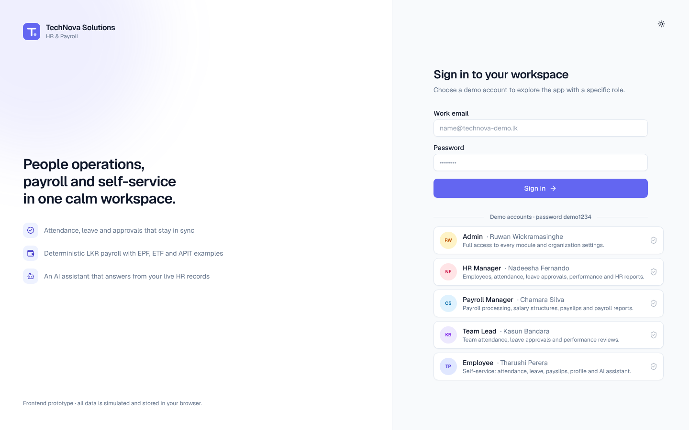

**Video Walkthrough:** [01 — Application overview](videos/01-application-overview.webm)

**Notes:**
- Every demo account uses the password `demo1234`. Wrong credentials show an error message; empty fields show inline validation.
- Opening a protected page while signed out redirects to the login page and returns you there after signing in.

### Switching roles and signing out

**Purpose:** Compare roles quickly without retyping credentials.

**Who can use it:** Everyone.

**Navigation:** Profile menu (top-right) → Switch demo role

**Steps:**
1. Click your name and avatar in the top-right corner.
2. Under **Switch demo role**, click the role you want (your current role is marked *Current*).
3. To sign out, open the same menu and click **Log out**.

**Expected Result:** You are redirected to the new role's dashboard and a confirmation toast appears. Logging out returns you to the login page.

**Screenshot:**

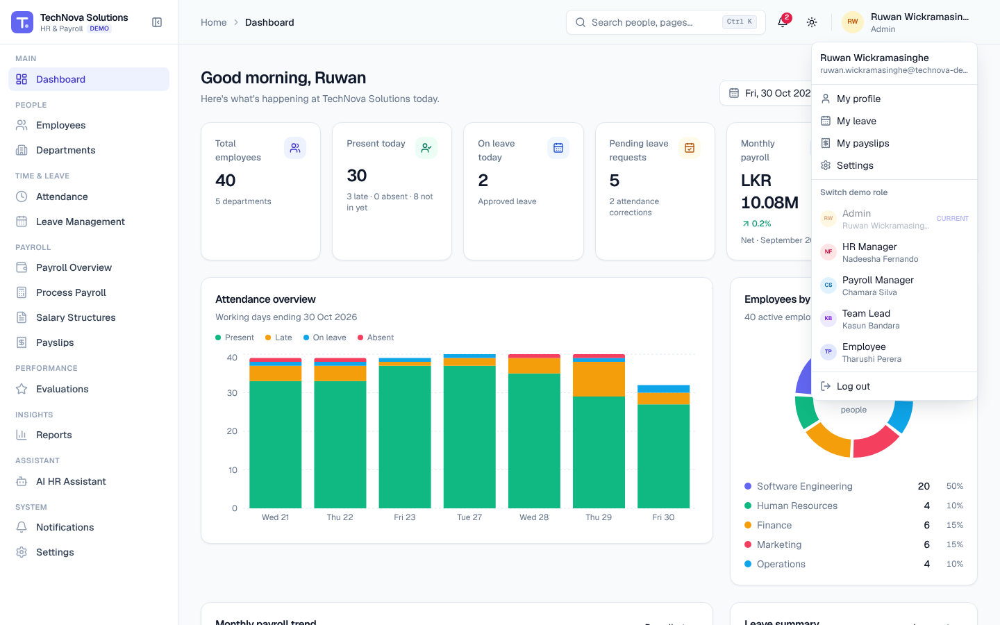

**Video Walkthrough:** [04 — Leave management](videos/04-leave-management.webm) (switches between Employee and Team Lead)

---

## 2. Navigation

### Sidebar, breadcrumbs and search

**Purpose:** Move around the application quickly.

**Who can use it:** Everyone (items depend on role).

**Navigation:** Left sidebar, header

**Steps:**
1. Use the **sidebar** sections (Main, People, Time & Leave, Payroll, Performance, Insights, Assistant, System). The current page is highlighted.
2. Click the **collapse** button next to the company name to shrink the sidebar to icons; hover an icon to see its label. Click **Expand sidebar** at the bottom to restore it.
3. Use the **breadcrumbs** in the header to go back up a level.
4. Click **Search people, pages…** or press **Ctrl K** (⌘K on macOS) to open the command palette. Type a page name, an action ("apply leave") or an employee's name and press Enter.
5. Inside modules, use the **tab row** under the page title (for example Overview · Calendar · Corrections · My Attendance) to switch between related pages.

**Expected Result:** The selected page opens and the sidebar highlight follows the current route.

**Screenshot:**

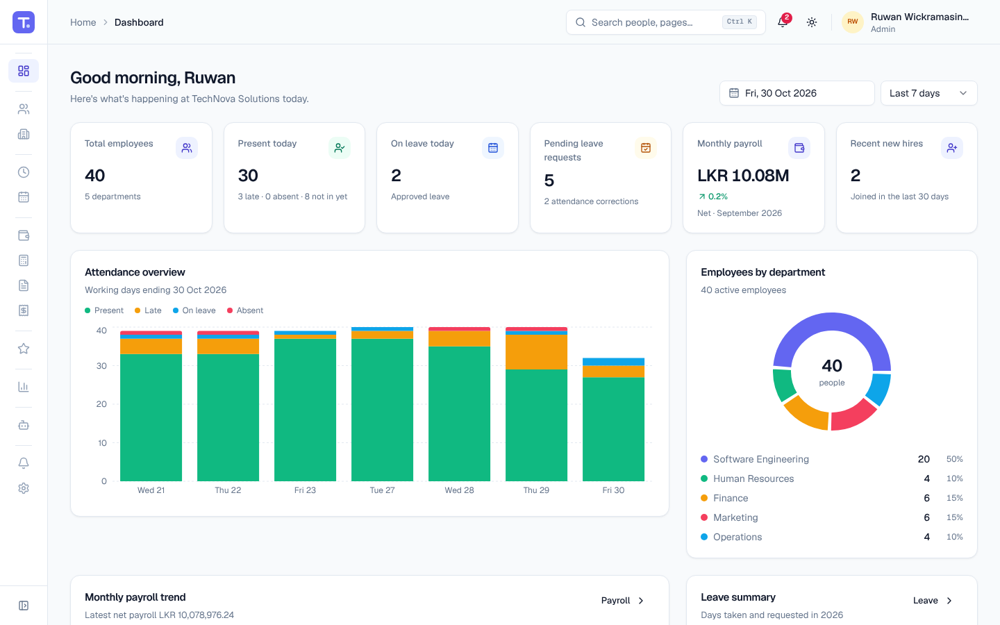

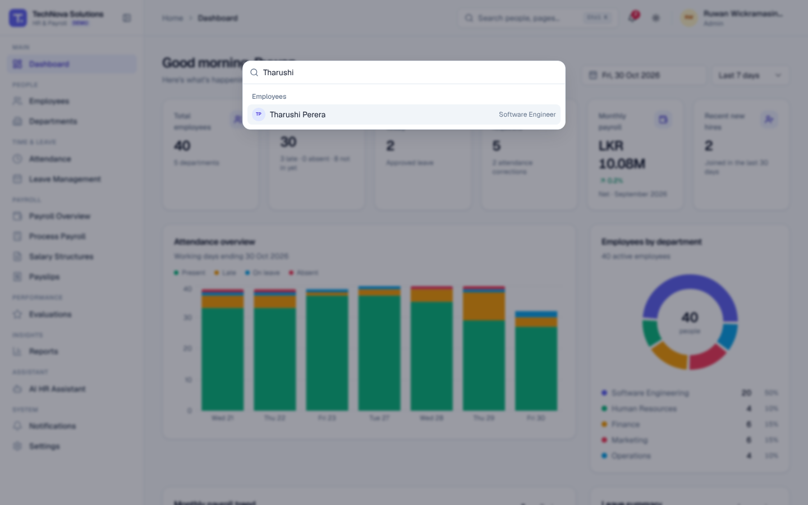

**Video Walkthrough:** [01 — Application overview](videos/01-application-overview.webm)

**Notes:** Employees get a simplified sidebar: My Dashboard, My Profile, My Attendance, My Leave, My Payslips, My Performance, AI Assistant, Notifications and Settings. Opening a page your role can't use shows an "access" message instead of the page.

---

## 3. Dashboard

### Organisation dashboard

**Purpose:** See today's headcount, attendance, leave, approvals and payroll at a glance.

**Who can use it:** Admin, HR Manager (HR figures), Payroll Manager (payroll figures).

**Navigation:** Sidebar → Dashboard

**Steps:**
1. Review the KPI cards: **Total employees**, **Present today**, **On leave today**, **Pending leave requests**, **Monthly payroll** and **Recent new hires**. Each card is a link to the related module.
2. Use the **Dashboard date** picker to view attendance and leave for an earlier day, and the range selector (Last 7 / 14 / 30 days) to change the attendance chart.
3. Hover over any chart to see tooltips: Attendance overview, Employees by department, Monthly payroll trend and Leave summary.
4. Work through **Pending approvals**, read **Recent HR activity**, and check **Upcoming birthdays** and **Work anniversaries**.
5. Use **Quick actions** (Add employee, Review leave, Process payroll, New evaluation, Apply for leave) or the **AI HR Assistant** shortcuts.

**Expected Result:** All figures come from the live demo records — for example approving a leave request or processing payroll updates the dashboard immediately.

**Screenshot:**

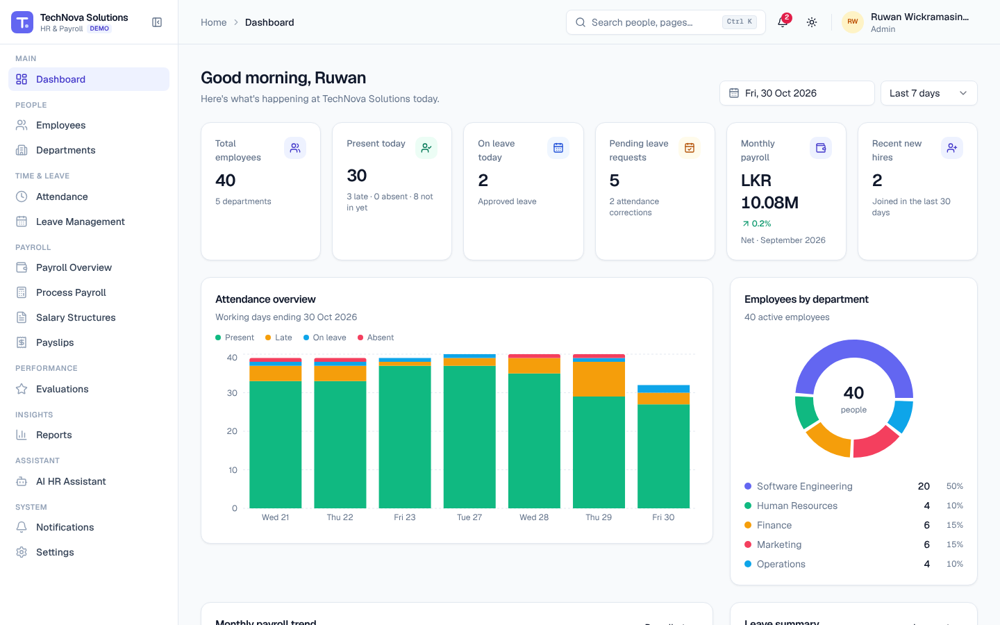

**Video Walkthrough:** [01 — Application overview](videos/01-application-overview.webm)

**Notes:** The Payroll Manager dashboard focuses on payroll (monthly payroll, employees paid, current period status, calculation warnings, employer cost and a cost breakdown) and hides HR metrics:

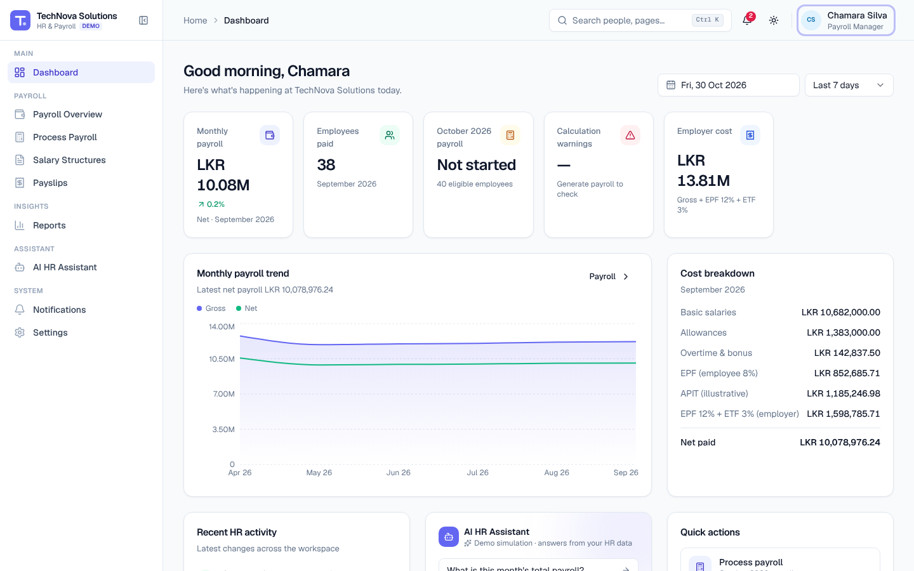

### Team lead dashboard

**Purpose:** Monitor your direct reports.

**Who can use it:** Team Lead.

**Navigation:** Sidebar → Dashboard

**Steps:**
1. Check **Team members**, **Present today**, **On leave today** and **Pending approvals**.
2. Review the **Team attendance** chart for the last seven working days.
3. Open items from **Pending approvals** (leave and attendance corrections from your team).
4. Clock yourself in or out from the clock card, and check your team's average performance rating.

**Expected Result:** Every figure is limited to employees who report to you.

**Screenshot:**

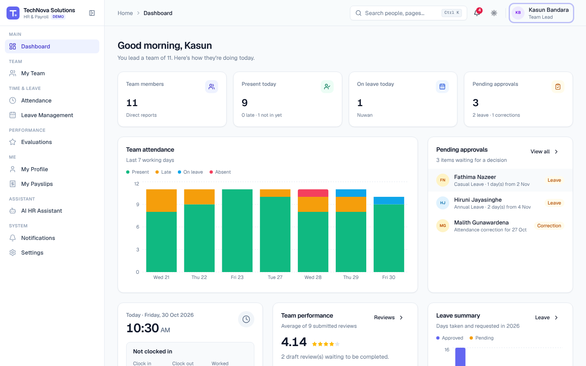

**Video Walkthrough:** [04 — Leave management](videos/04-leave-management.webm)

The employee dashboard is described in [Employee self-service](#13-employee-self-service).

---

## 4. Employee management

### Searching, filtering and sorting the directory

**Purpose:** Find employees quickly.

**Who can use it:** Admin, HR Manager. Team Leads see **My Team** (their direct reports, read-only).

**Navigation:** Sidebar → Employees

**Steps:**
1. Type in **Search by name, email, ID or role…**.
2. Use **All departments** to filter by department and **Current staff** to filter by status (Active, Probation, Notice period, Archived, All).
3. Click a column header (Employee, ID, Department, Designation, Joining date, Status) to sort; click again to reverse.
4. Use the pagination controls at the bottom (rows per page, previous/next).
5. Click **Export CSV** to download the filtered list.

**Expected Result:** The table updates instantly; "Showing 1–10 of 40" reflects the filtered count. If nothing matches, an empty state offers **Clear filters**.

**Screenshot:**

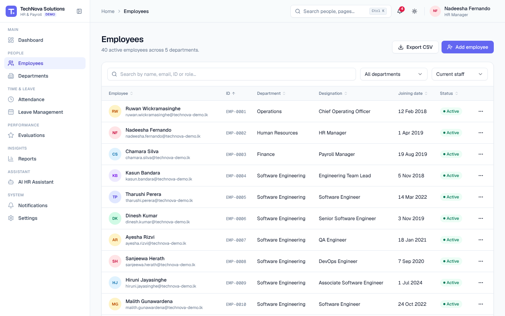

**Video Walkthrough:** [02 — Employee management](videos/02-employee-management.webm)

### Adding an employee

**Purpose:** Create a new employee record with personal, employment, salary and additional information.

**Who can use it:** Admin, HR Manager.

**Navigation:** Employees → Add employee

**Steps:**
1. Click **Add employee**.
2. **Personal information:** first and last name, work email, phone, date of birth (use the year and month dropdowns in the calendar), gender, address and an emergency contact.
3. **Employment information:** the employee ID is generated automatically (e.g. `EMP-0041`); choose a department, then a designation from that department, a reporting manager (searchable), joining date, employment type and status.
4. **Salary information:** basic salary, transport, meal and other allowances, currency and payment frequency (monthly).
5. **Additional information:** add skills (type and press Enter), notes, and optionally upload a profile photo.
6. Click **Add employee**.

**Expected Result:** The record is saved, a success toast appears and the new employee's profile opens. The directory count increases, and Admin, the Payroll Manager and the reporting manager receive notifications.

**Screenshot:**

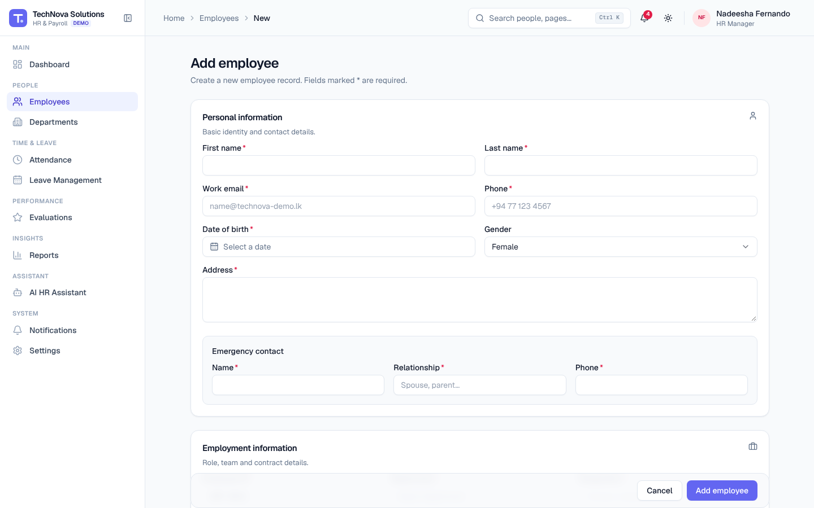

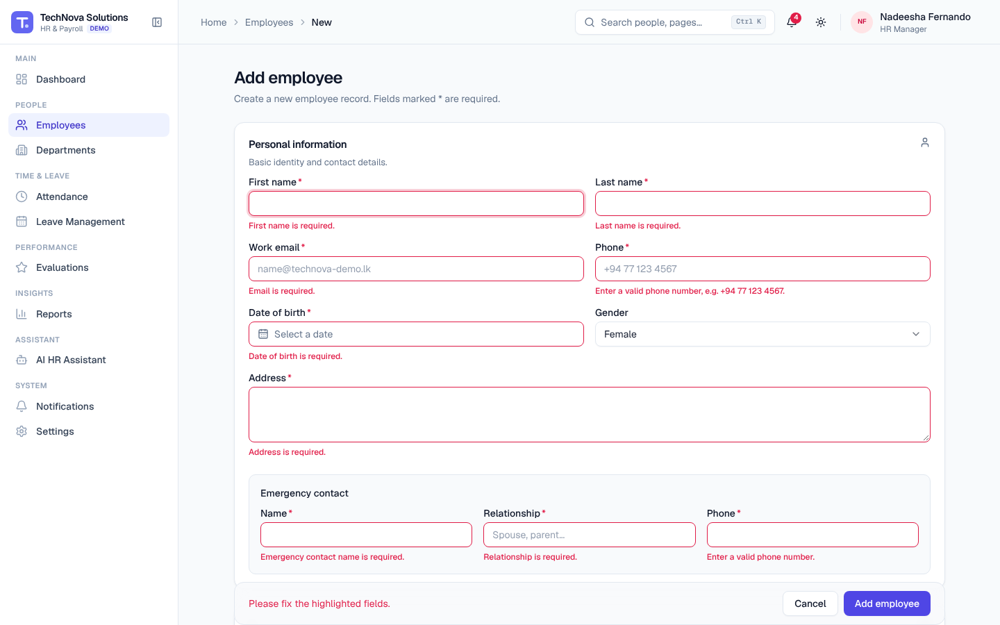

**Video Walkthrough:** [02 — Employee management](videos/02-employee-management.webm)

**Notes:** Required fields are marked `*`. Email addresses and IDs must be unique, phone numbers must be valid and the date of birth must be before the joining date. If you click **Cancel** with unsaved changes you are asked to confirm before they are discarded.

### Viewing an employee profile

**Purpose:** See everything about one employee in one place.

**Who can use it:** Admin, HR Manager, the employee's Team Lead; every employee can see their own profile (**My Profile**).

**Navigation:** Employees → click a name

**Steps:**
1. Review the header: photo, name, designation, department, status, email, phone, reporting manager and joining date with tenure.
2. Switch between the tabs: **Overview**, **Employment**, **Attendance**, **Leave**, **Payroll** and **Performance**.

**Expected Result:** Each tab shows that employee's live records — leave balances, attendance history, payslips, evaluations and goals.

**Screenshot:**

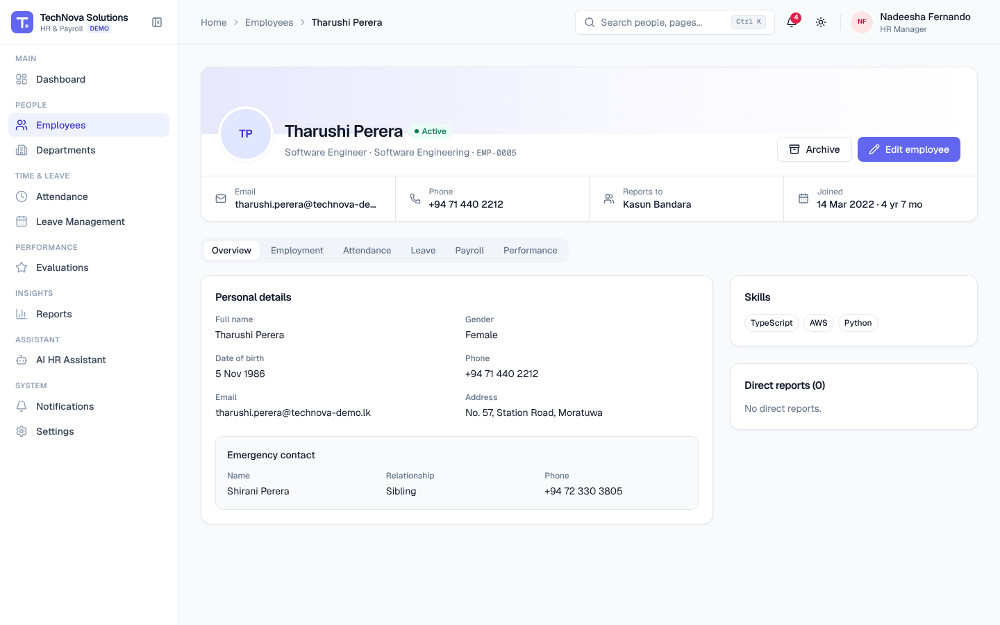

**Video Walkthrough:** [02 — Employee management](videos/02-employee-management.webm)

**Notes:** The **Payroll** tab is only visible to roles allowed to see salaries (Admin, HR Manager, Payroll Manager) and to the employee themselves.

### Editing an employee

**Purpose:** Update an employee's details.

**Who can use it:** Admin, HR Manager.

**Navigation:** Employees → row actions (⋯) → Edit, or profile → Edit employee

**Steps:**
1. Open the edit form — all fields are pre-filled.
2. Change the details you need.
3. Click **Save changes**.

**Expected Result:** The profile opens with the new values and a "Employee updated" toast. Changes persist after a page refresh.

**Screenshot:**

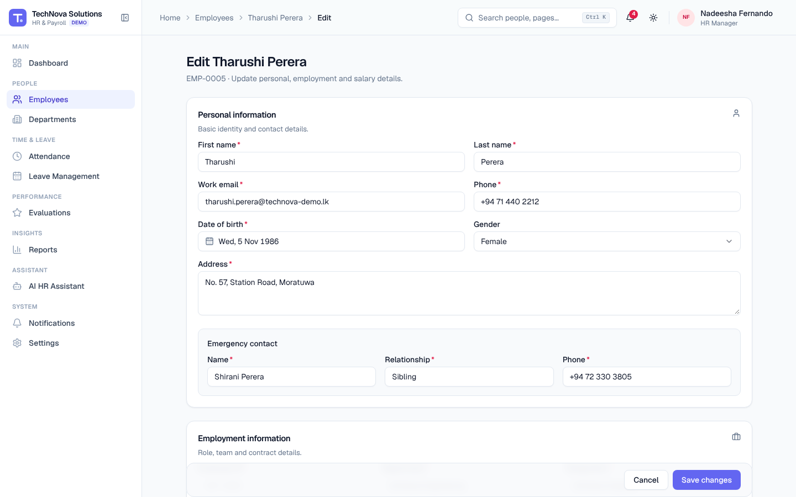

**Video Walkthrough:** [02 — Employee management](videos/02-employee-management.webm)

### Archiving and restoring an employee

**Purpose:** Remove leavers from the active directory without deleting their history.

**Who can use it:** Admin, HR Manager.

**Navigation:** Employees → row actions (⋯) → Archive

**Steps:**
1. Open the row's actions menu and choose **Archive**.
2. Read the confirmation (archived employees are hidden, excluded from future payroll runs and can be restored) and click **Archive employee**.
3. To restore, set the status filter to **Archived**, open the row's actions and choose **Restore**.

**Expected Result:** The active headcount drops by one; after restoring it returns.

**Screenshot:**

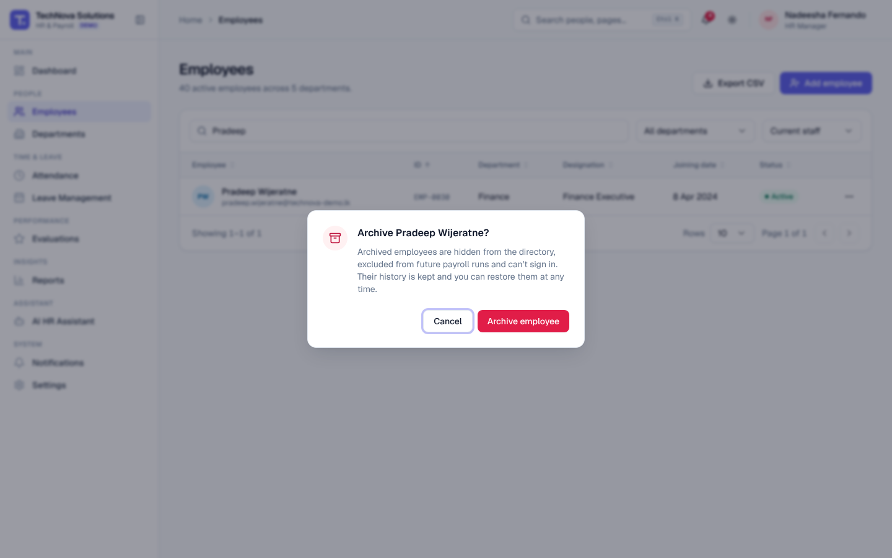

**Video Walkthrough:** [02 — Employee management](videos/02-employee-management.webm)

---

## 5. Departments and designations

### Managing departments

**Purpose:** Maintain the organisation structure used across every module.

**Who can use it:** Admin, HR Manager.

**Navigation:** Sidebar → Departments (also Settings → Departments)

**Steps:**
1. Review the headcount chart and the department cards (code, description, head, headcount, designations).
2. Click **Add department**, enter a name, a 2–5 letter code, description, department head and colour, then click **Add department**.
3. Use a card's actions menu (⋯) to **Edit** or **Archive** a department.
4. Turn on **Show archived** to see and **Restore** archived departments.

**Expected Result:** New departments are immediately available in the employee form, filters and reports.

**Screenshot:**

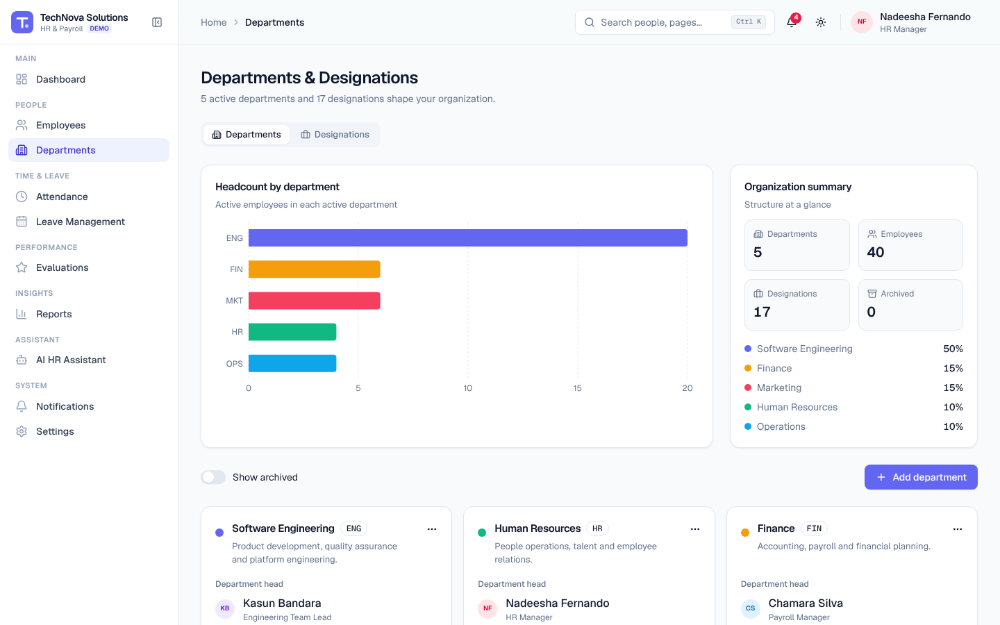

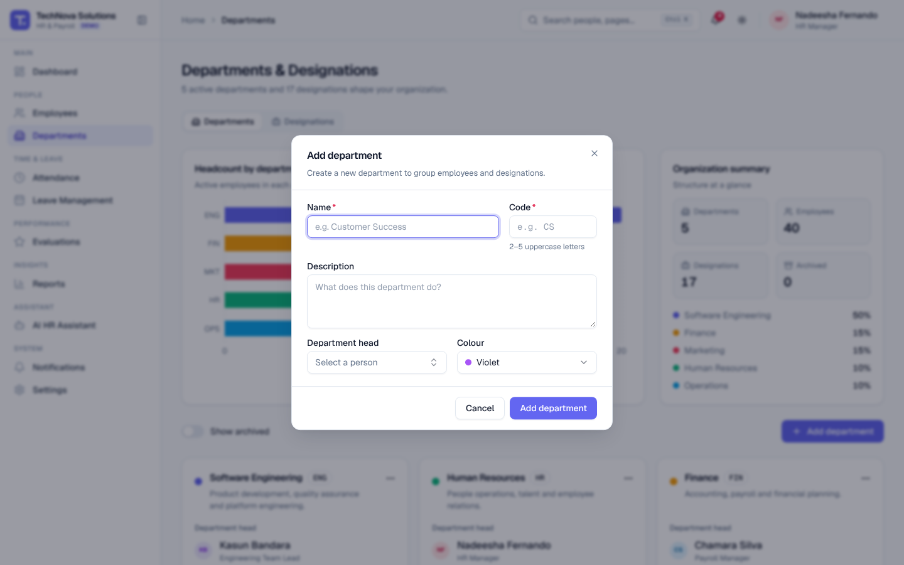

**Notes:** Codes must be unique. A department that still has active employees can't be archived — you'll see an explanation instead.

### Managing designations

**Purpose:** Maintain job titles per department.

**Who can use it:** Admin, HR Manager.

**Navigation:** Departments → Designations tab

**Steps:**
1. Search or filter the designation list by department or status.
2. Click **Add designation**, enter the title, department and level, and save.
3. Use the row actions to **Edit**, **Archive** or **Restore**.

**Expected Result:** Designations appear in the employee form once their department is chosen.

**Screenshot:**

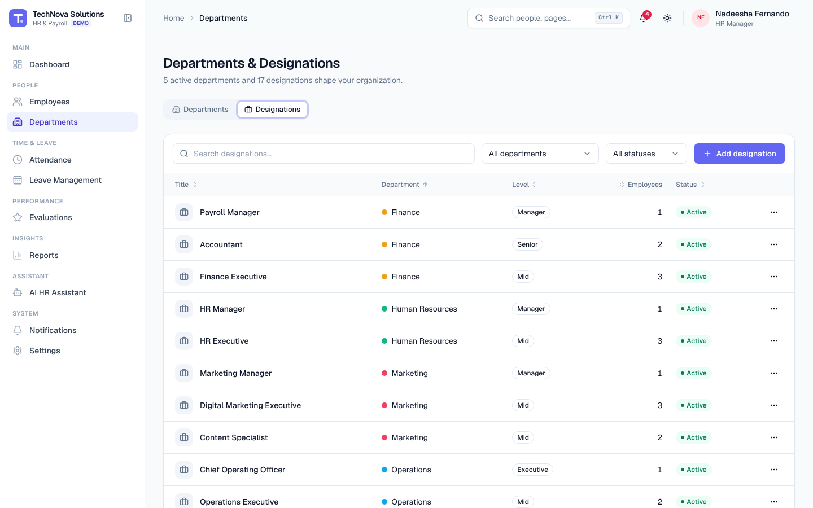

**Notes:** Designations that are assigned to employees can't be archived.

---

## 6. Attendance

### Clocking in and out

**Purpose:** Record working time.

**Who can use it:** Everyone (for themselves).

**Navigation:** Sidebar → My Attendance (or the clock card on the dashboard)

**Steps:**
1. Check today's card — it shows the current time and your status (*Not clocked in*).
2. Click **Clock in**. Your local time is recorded and the status changes to *Working since …*.
3. At the end of the day click **Clock out**.

**Expected Result:** A toast confirms each action; after clocking out you see the hours worked (for example *Completed — 7h 35m*) and today's row appears in your attendance history. Arrivals after 09:15 (09:00 + 15 minutes' grace) are marked **Late**.

**Screenshot:**

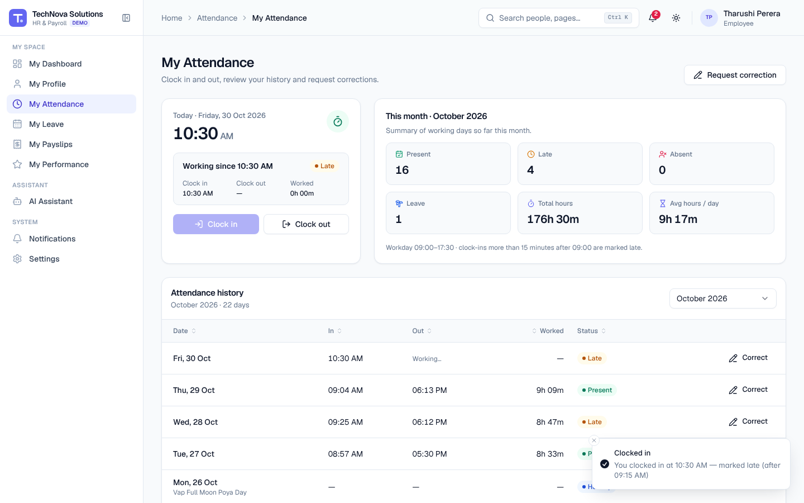

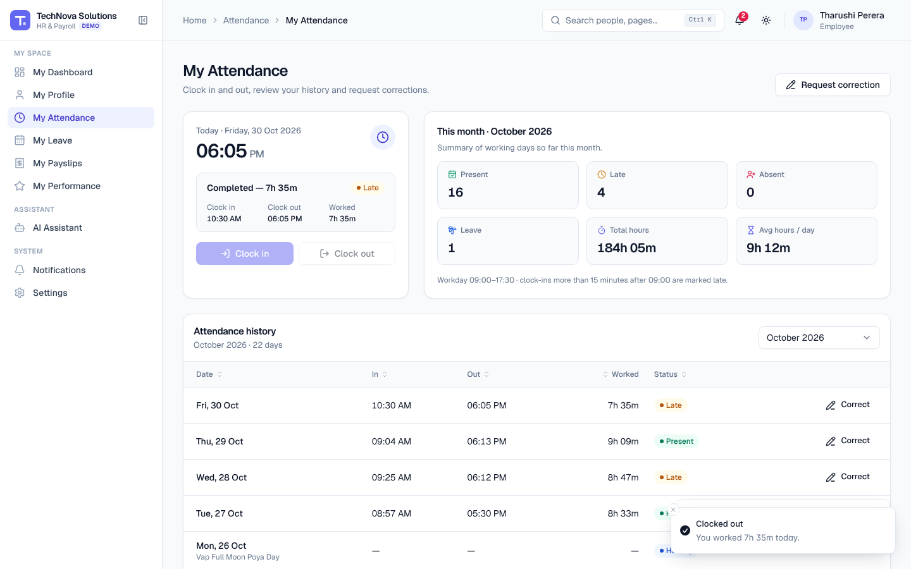

**Video Walkthrough:** [03 — Attendance management](videos/03-attendance-management.webm)

**Notes:** The buttons are disabled on weekends, public holidays and days you are on approved leave, with an explanation.

### Viewing attendance history

**Purpose:** Review your own attendance.

**Who can use it:** Everyone.

**Navigation:** My Attendance

**Steps:**
1. Review this month's summary (present, late, absent, leave, total and average hours).
2. Choose a **Month** to see the history table (date, in, out, worked, status).

**Expected Result:** The history reflects clock-ins, approved corrections and leave.

**Screenshot:**

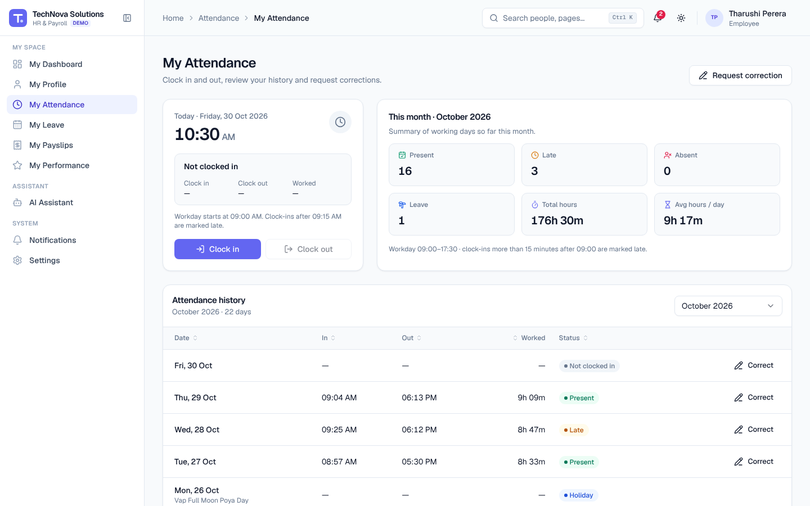

**Video Walkthrough:** [03 — Attendance management](videos/03-attendance-management.webm)

### Requesting an attendance correction

**Purpose:** Fix a missed or wrong clock-in/out.

**Who can use it:** Everyone (for themselves).

**Navigation:** My Attendance → Request correction (or **Correct** on a history row)

**Steps:**
1. Click **Request correction**.
2. Pick the **Date** (past working days only). The corrected times are pre-filled from the existing record.
3. Adjust **Corrected clock in** / **Corrected clock out** and enter a **Reason** (at least 10 characters).
4. Click **Submit request**.

**Expected Result:** The request appears under *My correction requests* as **Pending**; your manager and HR are notified.

**Screenshot:**

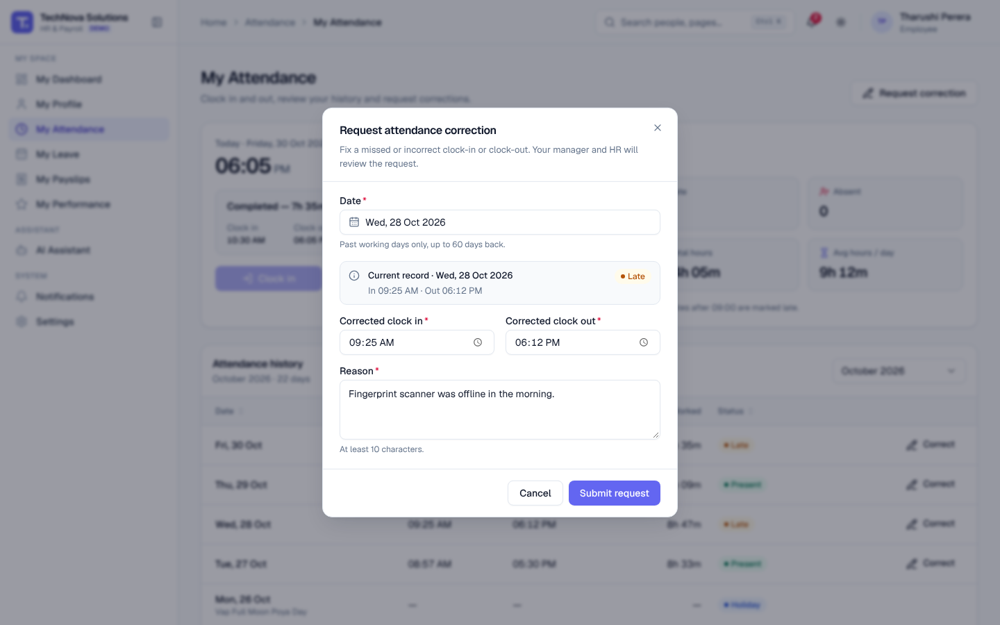

**Video Walkthrough:** [03 — Attendance management](videos/03-attendance-management.webm)

**Notes:** Clock-out must be after clock-in, and you can't have two pending requests for the same day.

### Daily attendance and the department overview

**Purpose:** See who is in, late, absent or on leave.

**Who can use it:** Admin, HR Manager (everyone), Team Lead (team).

**Navigation:** Sidebar → Attendance → Overview

**Steps:**
1. Pick a **Date** (defaults to today).
2. Read the KPI cards (Present, Late, Absent, On leave, Not clocked in yet) and the **Department attendance** chart.
3. Filter the daily table by department or status, or search for a person.

**Expected Result:** Weekends and holidays show a clear "No working day" message instead of empty data.

**Screenshot:**

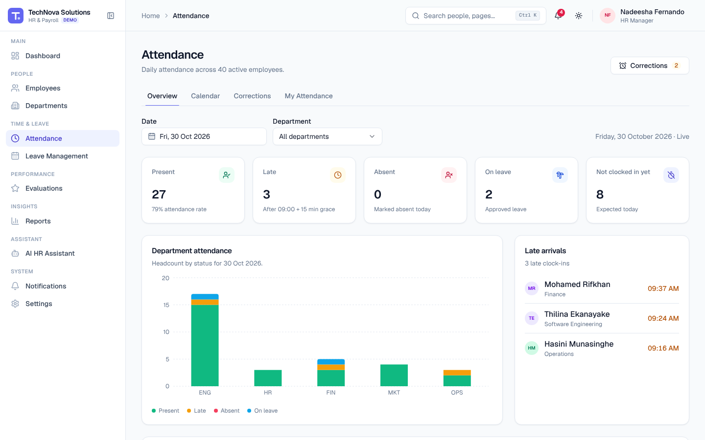

**Video Walkthrough:** [03 — Attendance management](videos/03-attendance-management.webm)

### Attendance calendar

**Purpose:** View one employee's month at a glance.

**Who can use it:** Admin, HR Manager, Team Lead.

**Navigation:** Attendance → Calendar

**Steps:**
1. Choose an **Employee**.
2. Use **Previous month** / **Next month** to move between months.

**Expected Result:** Each day shows its status colour and clock times; weekends and holidays are shaded and a monthly summary is shown alongside.

**Screenshot:**

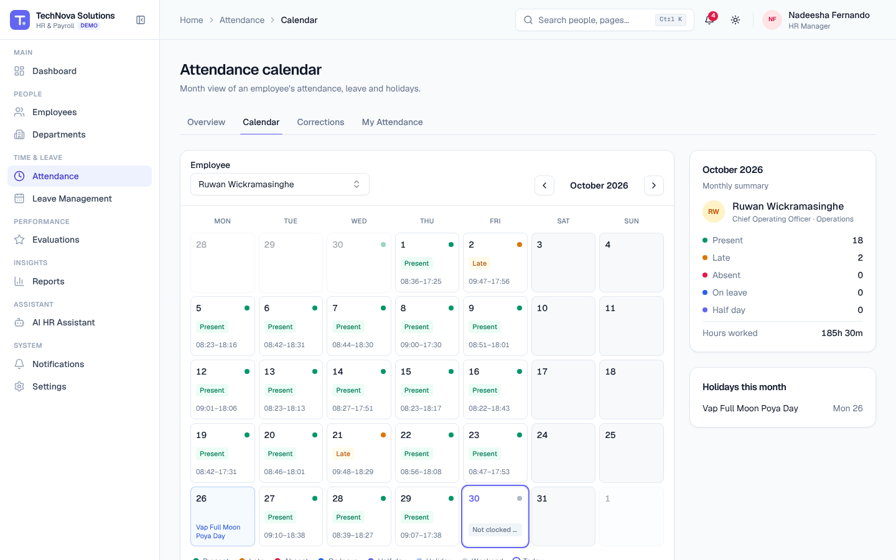

### Approving attendance corrections

**Purpose:** Review correction requests.

**Who can use it:** Admin, HR Manager, Team Lead (team only).

**Navigation:** Attendance → Corrections

**Steps:**
1. Open the **Pending** tab.
2. Click **Approve** or **Reject** on a request.
3. Review the requested vs. original times, add a **Comment** (required to reject) and confirm.

**Expected Result:** Approving updates the employee's attendance record (and its Late/Present status); the employee is notified either way.

**Screenshot:**

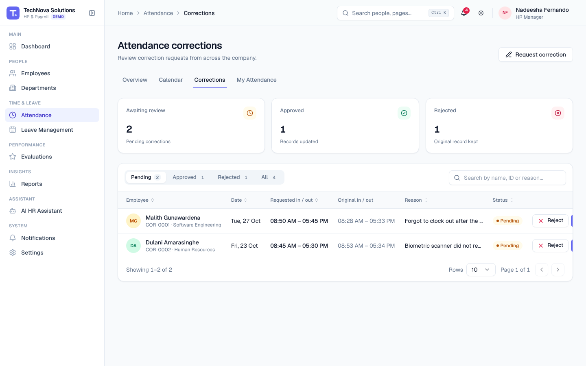

**Video Walkthrough:** [03 — Attendance management](videos/03-attendance-management.webm)

---

## 7. Leave applications

### Checking your leave balance

**Purpose:** Know how much leave you have left.

**Who can use it:** Everyone.

**Navigation:** Sidebar → My Leave

**Steps:**
1. Review the balance cards for Annual, Casual, Medical and Unpaid leave (available / allocated, used and pending).
2. Scroll to **My requests** to see your history and filter by status.

**Expected Result:** Balances already subtract approved *and* pending days, so they always match your requests.

**Screenshot:**

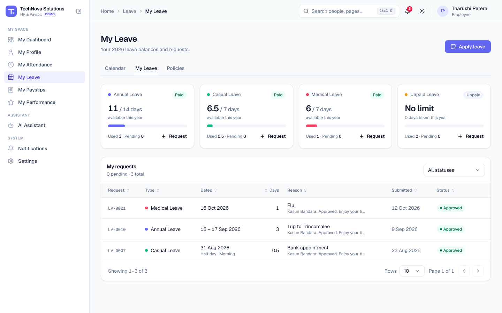

**Video Walkthrough:** [04 — Leave management](videos/04-leave-management.webm)

### Applying for annual leave

**Purpose:** Request time off.

**Who can use it:** Everyone.

**Navigation:** Dashboard → Leave Management → Apply Leave (employees: My Leave → Apply leave)

**Steps:**
1. Open the **Apply leave** page.
2. Click **Apply leave**.
3. Select the **Leave type**.
4. Select the **Start date** and **End date** (weekends, public holidays and past dates are disabled).
5. Optionally turn on **Half day** (start and end must be the same day) and choose Morning or Afternoon.
6. Enter a **Reason** and optionally attach a document.
7. Review the **Summary** panel: working days requested, balance before and after, and the leave-type rules.
8. Click **Submit request**.
9. Verify the success notification.

**Expected Result:** The leave request is created with **Pending** status, appears in *My requests*, and your manager and HR receive notifications.

**Screenshot:**

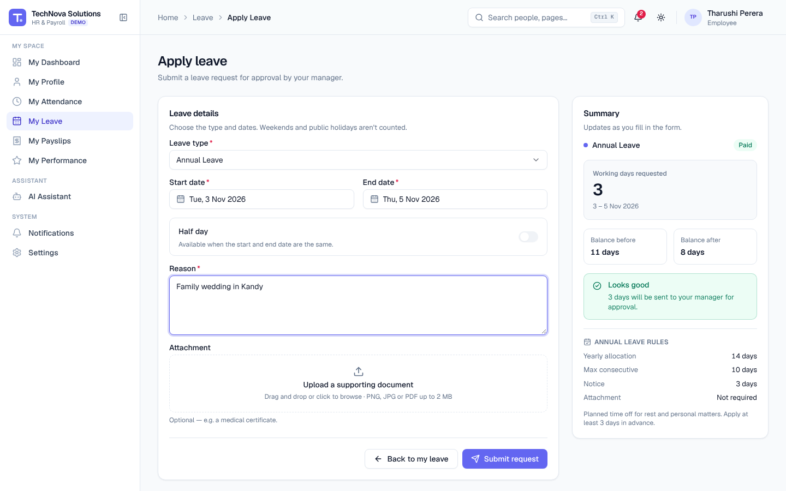

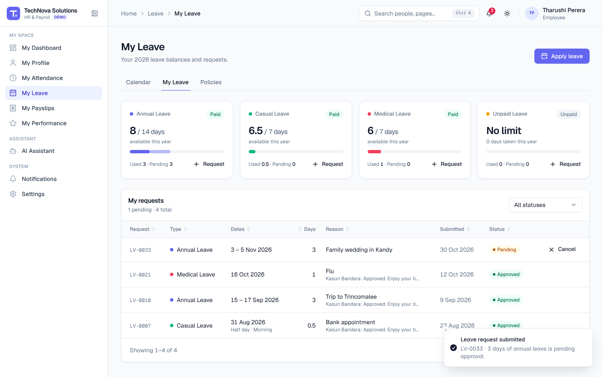

**Video Walkthrough:** [04 — Leave management](videos/04-leave-management.webm)

**Notes:** The form blocks requests that exceed your balance, overlap an existing pending/approved request, or exceed the type's maximum consecutive days. Unpaid leave has no limit and is deducted pro rata in payroll.

### Cancelling a request

**Purpose:** Withdraw a request you no longer need.

**Who can use it:** Everyone.

**Navigation:** My Leave → My requests → Cancel

**Steps:**
1. Click **Cancel** on a pending (or future approved) request.
2. Confirm with **Cancel request**.

**Expected Result:** The status changes to **Cancelled** and the days return to your balance.

### Leave calendar and policies

**Purpose:** See who is away and read the rules.

**Who can use it:** Everyone (scope depends on role).

**Navigation:** Leave → Calendar / Policies

**Steps:**
1. On **Calendar**, move between months. Approved leave is shown as solid chips, pending leave as outlined chips, plus public holidays and weekends.
2. On **Policies**, review each leave type's allocation, notice period, maximum consecutive days and attachment rules, the working-day rules and the public holiday list.

**Screenshot:**

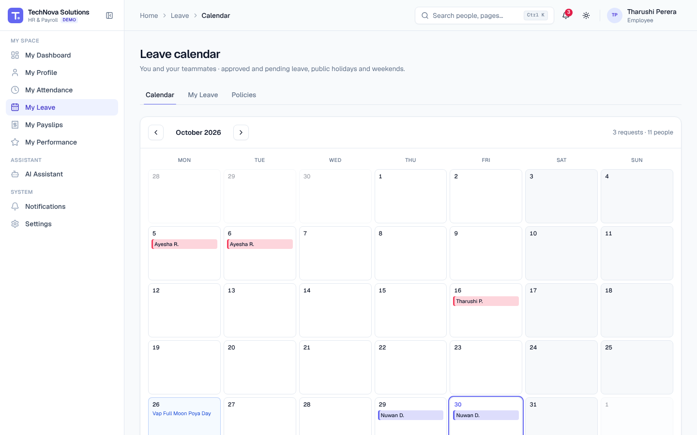

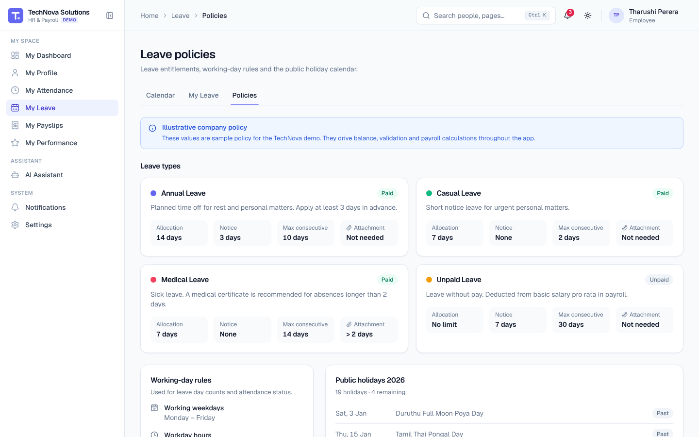

**Notes:** Policy values are illustrative and can be changed in **Settings → Leave policies**.

---

## 8. Leave approvals

### Approving or rejecting a leave request

**Purpose:** Decide on leave requests from your people.

**Who can use it:** Admin, HR Manager (everyone), Team Lead (direct reports).

**Navigation:** Sidebar → Leave Management → Requests

**Steps:**
1. Open the **Pending** tab (the default). Search or filter by leave type if needed.
2. Click **Approve** (or **Reject**) on the request.
3. In the dialog, review the dates, the employee's remaining balance and any overlapping team leave.
4. Add a **Comment** (optional for approval, required for rejection).
5. Click **Approve request** (or **Reject request**).

**Expected Result:** The row shows the new status, the employee gets a notification and their balance updates. The employee sees the decision under *My Leave*.

**Screenshot:**

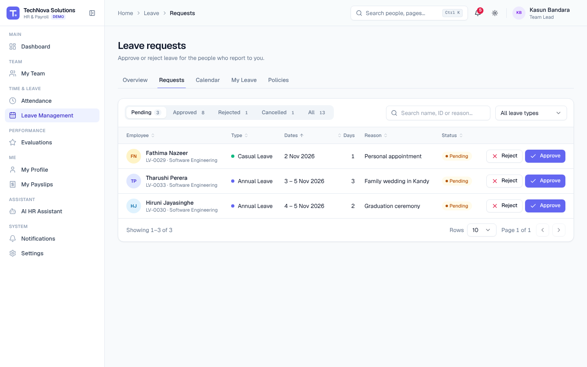

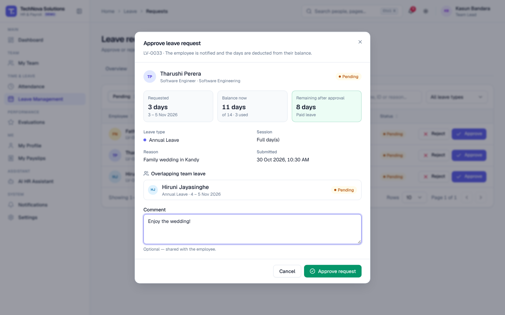

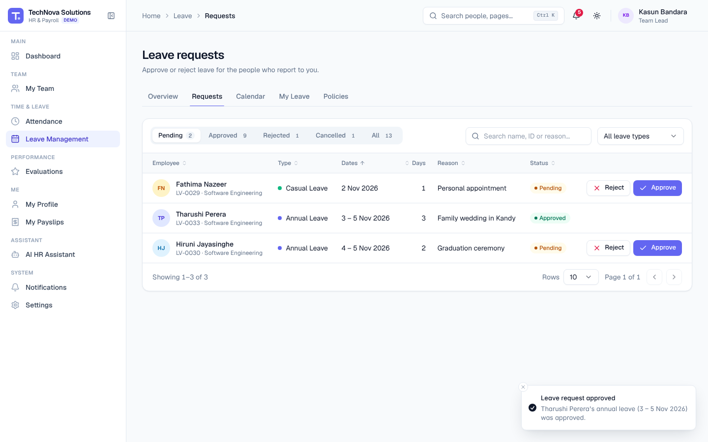

**Video Walkthrough:** [04 — Leave management](videos/04-leave-management.webm)

### Leave overview

**Purpose:** Understand leave across the organisation.

**Who can use it:** Admin, HR Manager, Team Lead.

**Navigation:** Leave Management → Overview

**Steps:** Review pending requests, who is on leave today, approved days this month, upcoming leave, leave by type and who's out this week.

**Screenshot:**

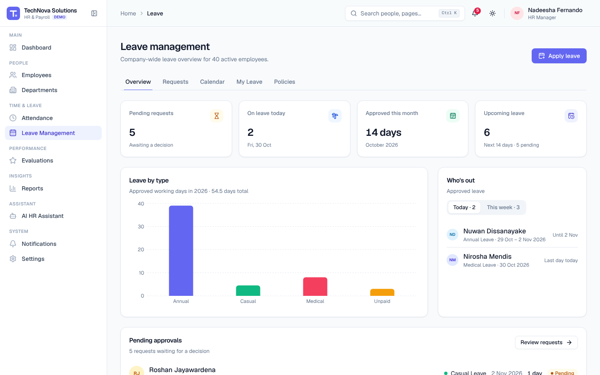

---

## 9. Payroll processing

### Payroll dashboard

**Purpose:** See the payroll position at a glance.

**Who can use it:** Admin, Payroll Manager.

**Navigation:** Sidebar → Payroll Overview

**Steps:**
1. Review **Total monthly payroll** (latest processed net, with change vs. the previous run), **Employees paid**, **Pending payroll** (current month status), **Completed payroll runs**, **Allowances** and **Deductions**.
2. Hover the **Payroll trend** chart (gross, net and employer cost per run).
3. Use the **Current period** card to start or continue this month's payroll.
4. Click **Export runs CSV** to download a summary of every run.

**Screenshot:**

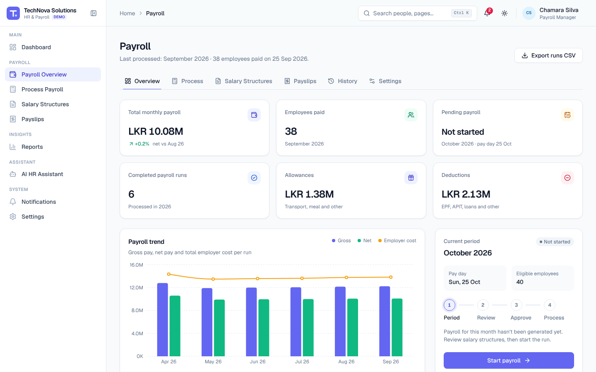

**Video Walkthrough:** [05 — Payroll management](videos/05-payroll-management.webm)

### Running monthly payroll

**Purpose:** Calculate, review, approve and process salaries for a month, then generate payslips.

**Who can use it:** Admin, Payroll Manager (in this demo both may approve).

**Navigation:** Sidebar → Process Payroll

**Steps:**
1. Select the **Payroll period** (defaults to the current month).
2. Click **Generate payroll**. The deterministic engine calculates earnings, deductions and net pay for every eligible employee.
3. Review the totals strip (employees, gross, deductions, net, employer cost, warnings).
4. Review the **warnings** panel — for example mid-month joiners (pro-rated pay), unpaid leave deductions, unexplained absences or deductions above 40% of gross.
5. Search the preview table and click any row to open the full **Payroll breakdown**.
6. Use **Recalculate** after changing salary structures, or **Discard draft** to start again.
7. Click **Submit for approval** → status becomes **Pending Approval**.
8. Click **Approve payroll** and confirm → status becomes **Approved**.
9. Click **Process payroll**, read the confirmation (*Process payroll for October 2026?*) and click **Process payroll**.
10. Click **View payslips**.

**Expected Result:** The run is marked **Processed**, payslips are generated for every employee in the run, each employee is notified, and the dashboard and reports include the new month.

**Screenshot:**

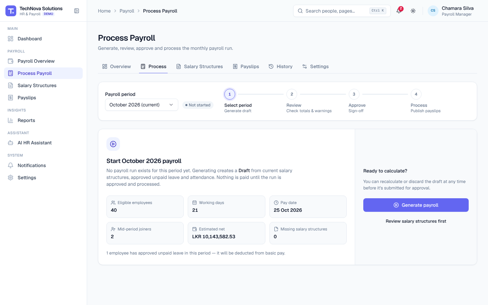

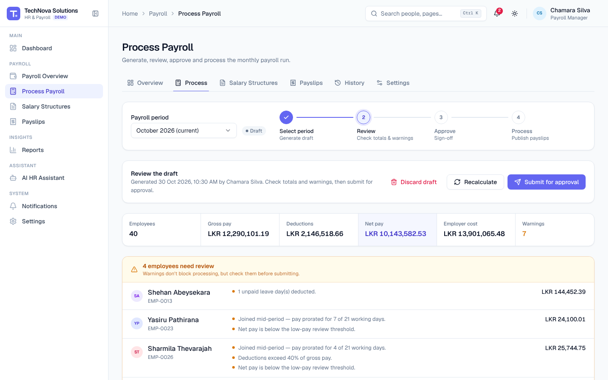

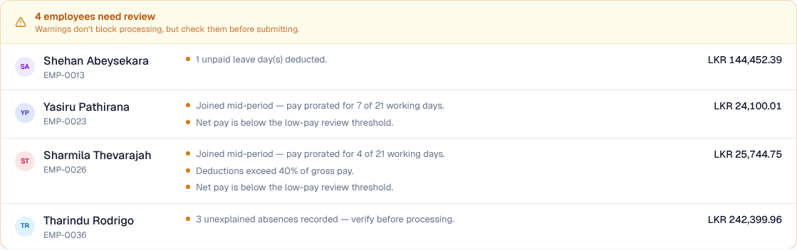

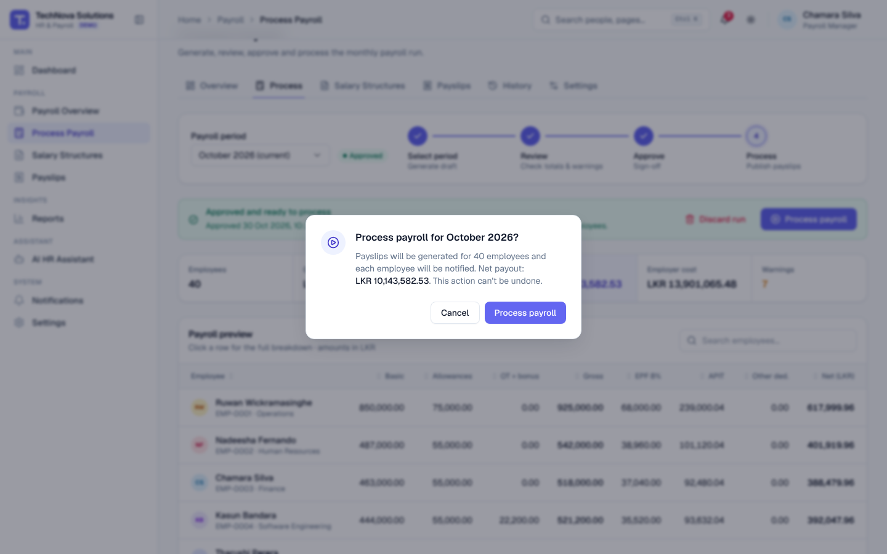

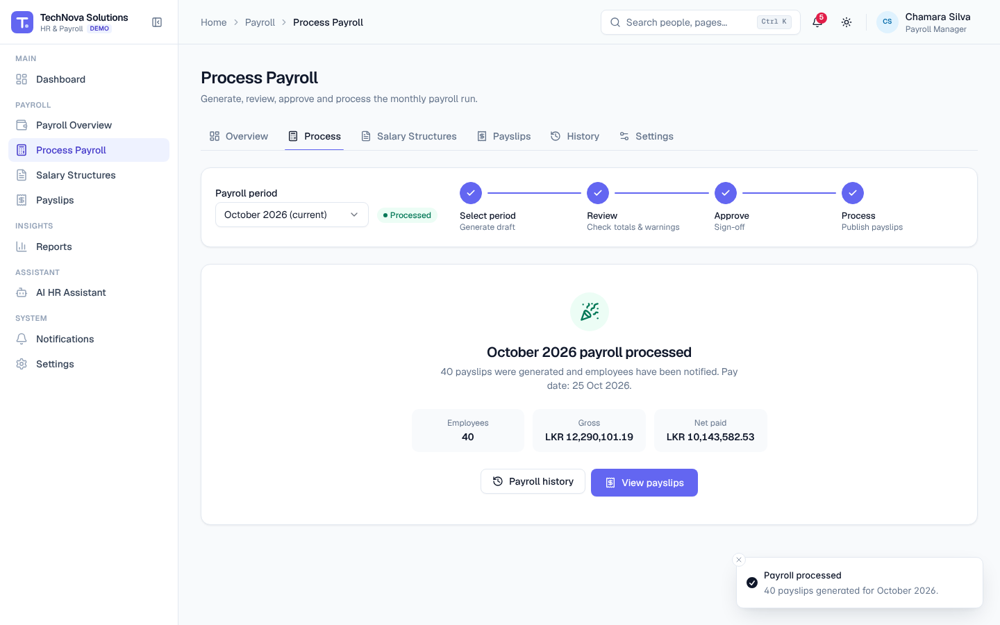

**Video Walkthrough:** [05 — Payroll management](videos/05-payroll-management.webm)

**Notes:**
- Statuses: **Draft → Pending Approval → Approved → Processed**.
- A processed period can't be processed again — the page shows *This period has already been processed* and no Process button.
- Calculation (illustrative): gross = basic + allowances + overtime (basic ÷ 240 h × 1.5 × hours) + bonus. Deductions = EPF 8% of basic (after unpaid leave) + APIT (example monthly brackets) + loans + other deductions + unpaid leave (basic ÷ working days × days). Employer EPF 12% and ETF 3% are shown as employer cost.

### Payroll history

**Purpose:** Review past runs.

**Who can use it:** Admin, Payroll Manager.

**Navigation:** Payroll → History

**Steps:** Review each run's period, status, employee count, gross, deductions, net and who processed it. Use **View payslips for …** or **Download CSV for …** to export a payroll register.

**Screenshot:**

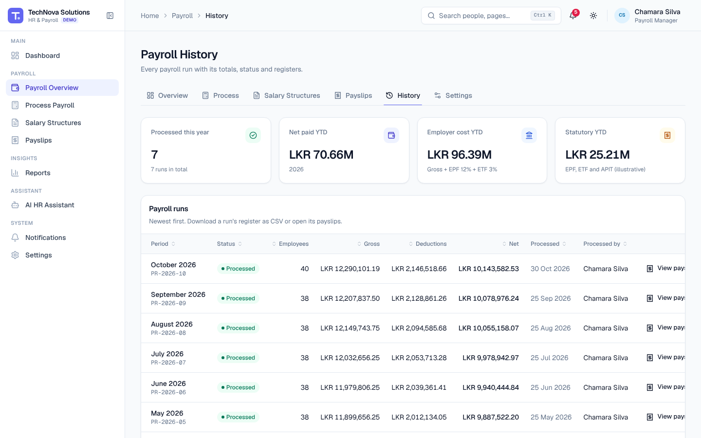

---

## 10. Salary structures

### Editing an employee's salary structure

**Purpose:** Maintain each employee's pay components.

**Who can use it:** Admin, Payroll Manager.

**Navigation:** Sidebar → Salary Structures

**Steps:**
1. Search or filter the **Employee salaries** table.
2. Click the edit button on a row (**Edit salary for EMP-…**).
3. Update **Basic salary**, **Transport allowance**, **Meal allowance**, **Other allowances**, **Bonus**, **Overtime hours**, **Loan deduction** or **Other deductions**.
4. Watch the **Live preview** (gross, EPF, APIT, net and employer contributions for the current month).
5. Click **Save changes**.

**Expected Result:** A "Salary structure updated" toast appears; the change applies to draft and future payroll runs (processed payslips are never altered).

**Screenshot:**

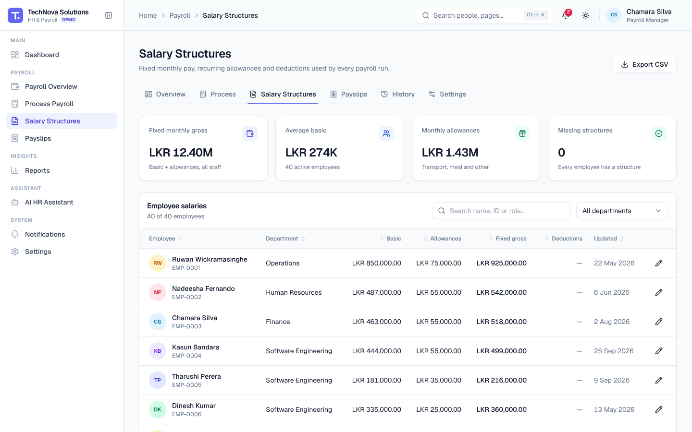

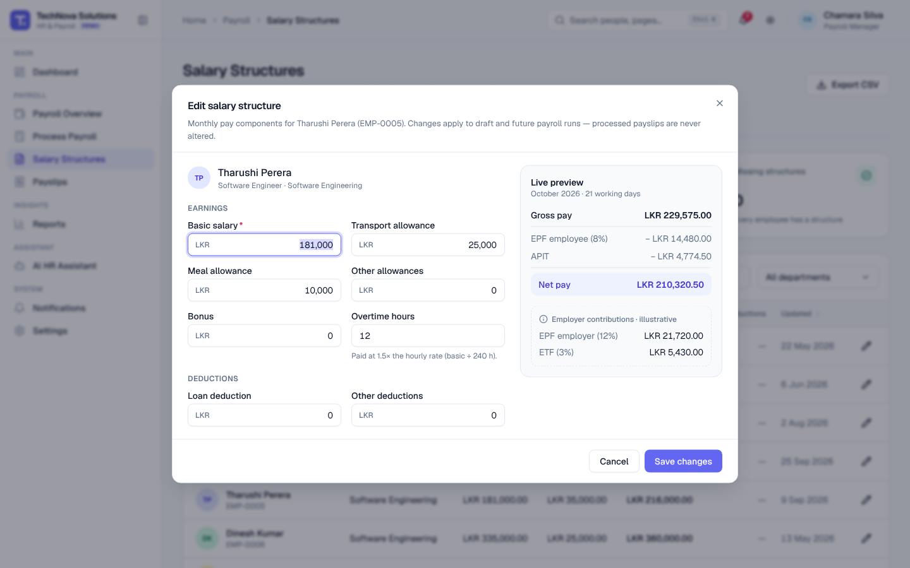

**Video Walkthrough:** [05 — Payroll management](videos/05-payroll-management.webm)

**Notes:** All amounts must be zero or more. Click **Export CSV** to download the salary table.

### Payroll settings

**Purpose:** Configure pay day, statutory example rates and APIT brackets.

**Who can use it:** Admin, Payroll Manager.

**Navigation:** Payroll → Settings (also Settings → Payroll)

**Steps:** Edit the pay day, overtime multiplier, standard monthly hours, low-pay review threshold, EPF/ETF percentages, enable/disable APIT and edit its brackets, then click **Save settings**.

**Screenshot:**

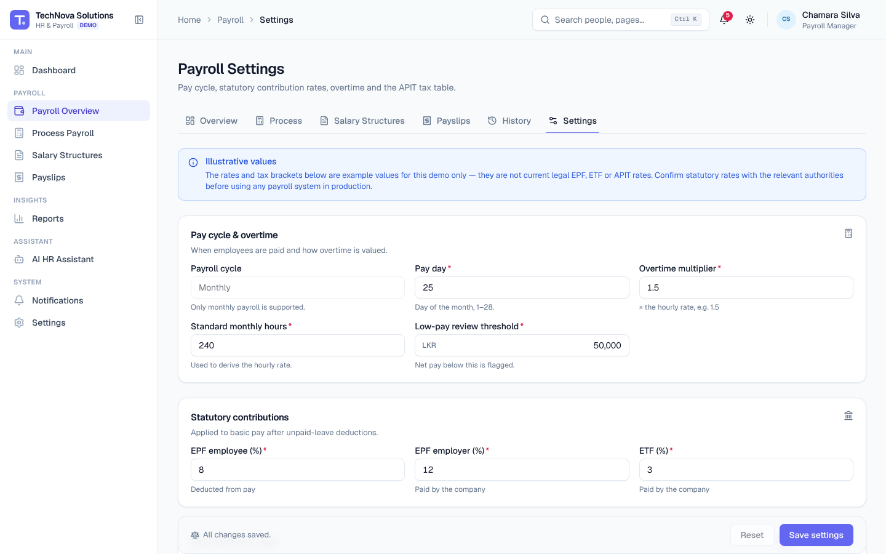

**Notes:** These are clearly labelled illustrative values, not current legal rates.

---

## 11. Payslips

### Viewing, printing and downloading a payslip

**Purpose:** Access payslips generated by processed payroll runs.

**Who can use it:** Admin and Payroll Manager (all payslips); everyone else (their own — **My Payslips**).

**Navigation:** Sidebar → Payslips / My Payslips

**Steps:**
1. Choose a **Period** and search (payroll roles), or open your **latest payslip** card (everyone else).
2. Click **View** on a payslip.
3. Review the company details, employee details, earnings, deductions, net pay and employer contributions.
4. Click **Print** for a clean printed copy, or **Download PDF** to save it.

**Expected Result:** A PDF named like `payslip-EMP-0005-2026-10.pdf` is downloaded and a toast confirms it.

**Screenshot:**

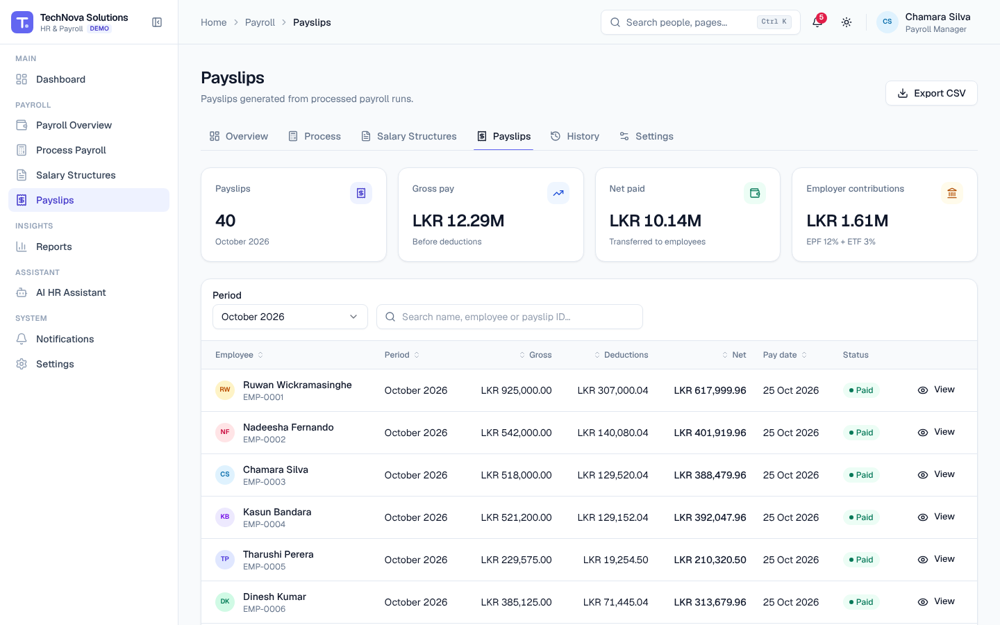

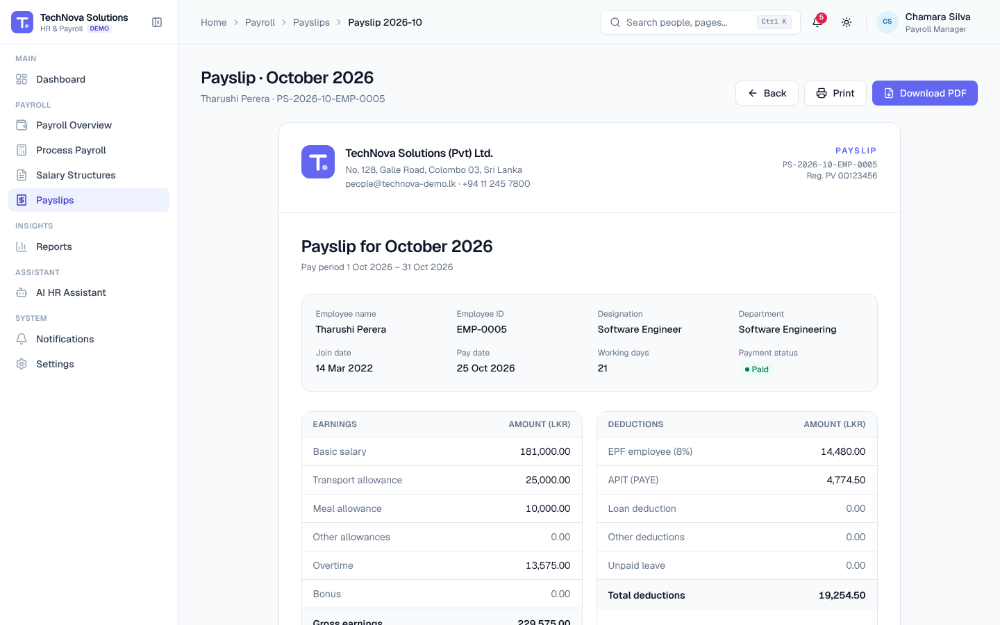

**Video Walkthrough:** [05 — Payroll management](videos/05-payroll-management.webm)

**Notes:** Opening someone else's payslip without permission shows an access message. Payslips print on white even in dark mode.

---

## 12. Performance evaluations

### Creating and submitting an evaluation

**Purpose:** Record a manager review on a 1–5 scale across seven criteria.

**Who can use it:** Admin, HR Manager, Team Lead (direct reports).

**Navigation:** Sidebar → Evaluations → New evaluation

**Steps:**
1. Click **New evaluation** (or **Start review** next to someone in *Due for review*).
2. Choose the **Employee**, **Review type** and **Review period**.
3. Rate each criterion from 1 to 5: Attendance & punctuality, Communication, Teamwork, Quality of work, Technical knowledge, Problem solving and Productivity. The **Overall rating** updates live.
4. Write **Strengths**, **Areas for improvement** and **Comments**.
5. Click **Save draft** to finish later, or **Submit evaluation**.

**Expected Result:** The evaluation details page opens with the overall rating and per-criterion bars; the employee and HR are notified.

**Screenshot:**

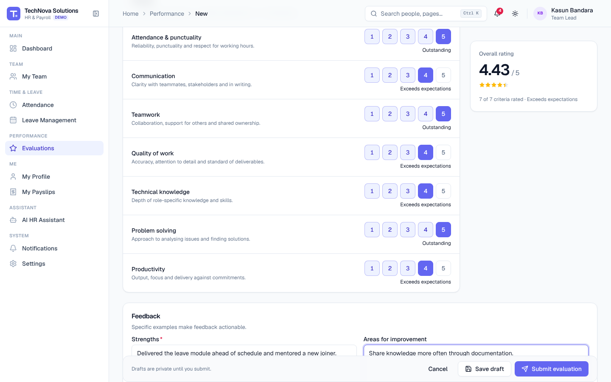

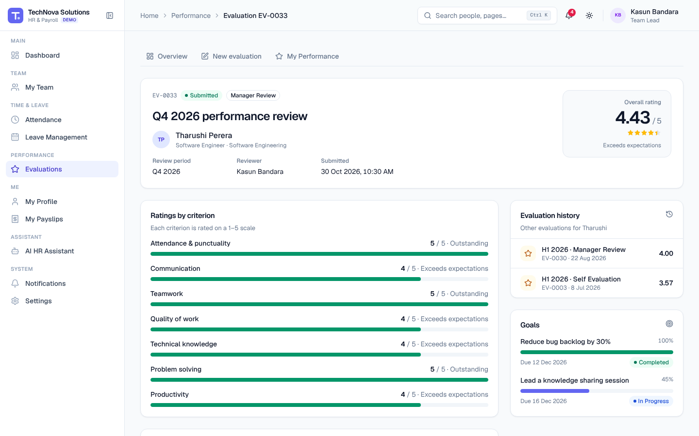

**Video Walkthrough:** [06 — Performance management](videos/06-performance-management.webm)

**Notes:** Submitting requires all seven ratings and at least one strength. Drafts can be edited or deleted from the details page.

### Performance overview

**Purpose:** Track review progress and ratings.

**Who can use it:** Admin, HR Manager, Team Lead.

**Navigation:** Evaluations → Overview

**Steps:** Review average rating, reviews submitted, drafts and goal completion, the rating distribution and department averages, then search or filter the evaluations list.

**Screenshot:**

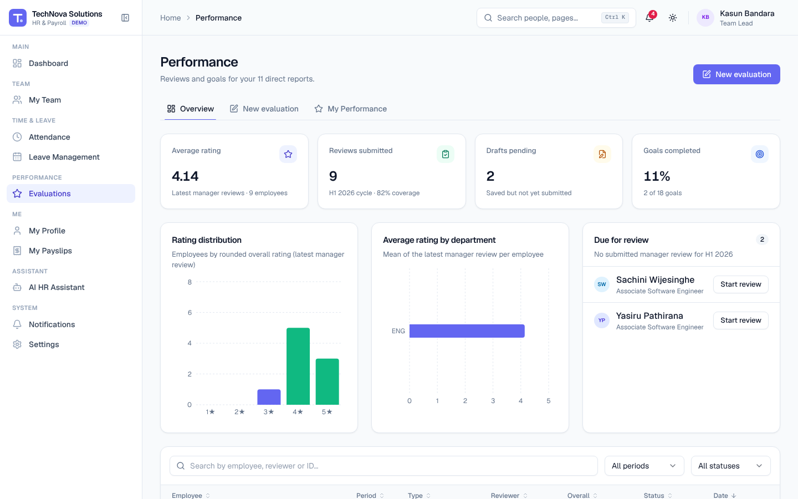

### My performance and goals

**Purpose:** See your reviews and track your goals.

**Who can use it:** Everyone.

**Navigation:** My Performance

**Steps:** Review your latest rating and history, update goal progress and click **Update**, click **Add goal** to create a goal, or **Start self evaluation**.

**Screenshot:**

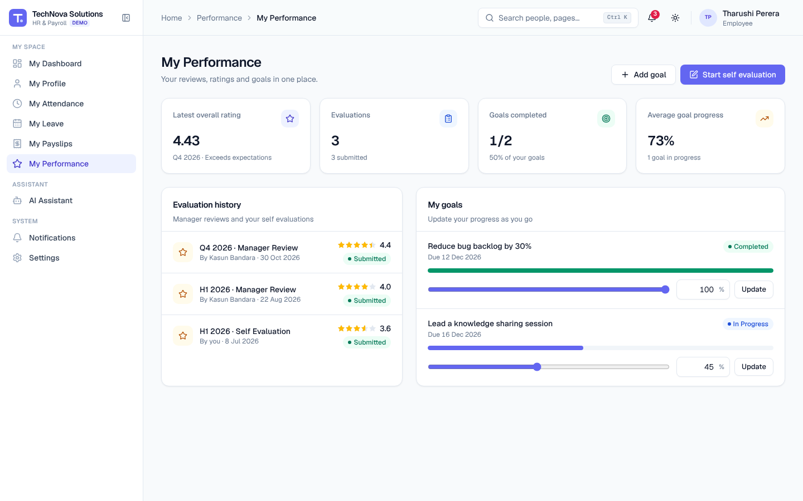

---

## 13. Employee self-service

### Employee dashboard

**Purpose:** Give employees everything they need without contacting HR.

**Who can use it:** Employee (and the "My …" pages for every role).

**Navigation:** Sidebar → My Dashboard

**Steps:**
1. Read the welcome greeting and today's date.
2. Use the clock card to **Clock in** / **Clock out**.
3. Check your **Leave balance** and click **Apply leave**.
4. Open your **Latest payslip**.
5. Review **Recent attendance**, **Pending requests**, **Upcoming holidays** and **My goals**.
6. Use **Quick actions** or the **AI HR Assistant** shortcuts.

**Expected Result:** Common tasks — attendance, leave, payslips, profile updates — can be completed directly.

**Screenshot:**

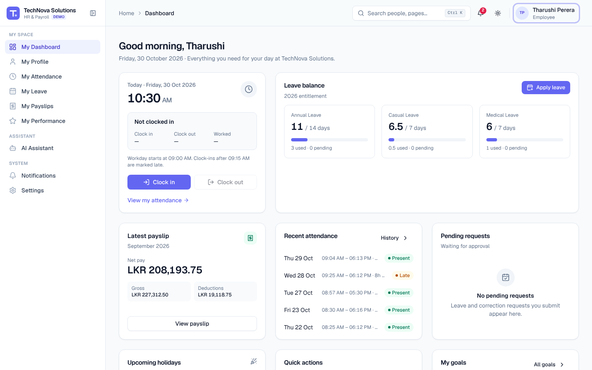

**Video Walkthrough:** [08 — Employee self-service](videos/08-employee-self-service.webm)

### Updating your contact details

**Purpose:** Keep your phone, address, emergency contact and photo current.

**Who can use it:** Everyone.

**Navigation:** My Profile → Update contact details

**Steps:** Edit the fields, optionally upload a new photo, and click **Save details**.

**Expected Result:** Your profile updates immediately and HR sees the new details.

See the [Employee Guide](EMPLOYEE_GUIDE.md) for a complete self-service walkthrough.

---

## 14. AI HR Assistant

### Asking questions

**Purpose:** Get instant answers from live HR records.

**Who can use it:** Everyone. Answers respect the current role's permissions.

**Navigation:** Sidebar → AI HR Assistant / AI Assistant

**Steps:**
1. Click a suggested question or type your own in **Ask about leave, attendance, payslips…** and press Enter.
2. Watch the typing indicator, then read the answer and its result card (figures, tables and links).
3. Click **Clear conversation** to start over.

**Expected Result:** Answers come from the same data as the rest of the app — e.g. "How many leave days do I have?" shows your real balances.

**Screenshot:**

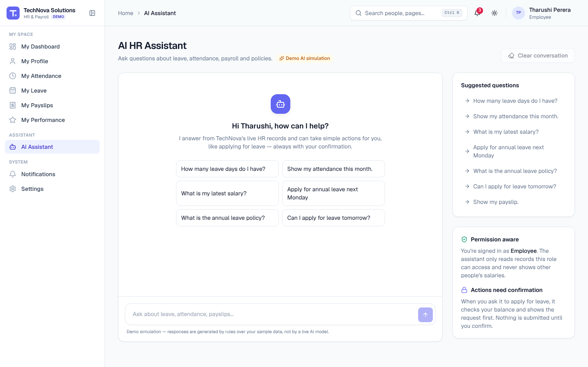

**Video Walkthrough:** [07 — AI HR Assistant](videos/07-ai-assistant.webm)

**Example questions:**

| Role | Try asking |
| --- | --- |
| Employee | How many leave days do I have? · Show my attendance this month. · What is my latest salary? · Can I apply for leave tomorrow? · Show my payslip. · What is the annual leave policy? |
| HR Manager | How many employees are absent today? · Show pending leave requests. · Which employees joined this month? · Summarize employee attendance. · How many employees work in IT? |
| Payroll Manager | What is this month's total payroll? · Are there any payroll calculation warnings? · Show pending payroll records. · Summarize salary expenses. |

### Applying for leave through the assistant

**Purpose:** Let the assistant prepare and submit a leave request for you.

**Who can use it:** Everyone (for themselves).

**Navigation:** AI Assistant

**Steps:**
1. Type a request such as **Apply for annual leave next Monday for 2 days** (you can also say "sick leave", "casual leave on 6 Nov", "from 3 Nov to 5 Nov").
2. The assistant identifies you, checks your balance and the rules, and shows a **Leave request · review before submitting** card with type, dates, working days, reason and balance after.
3. Click **Confirm and submit** (or **Cancel**).

**Expected Result:** A leave request (e.g. `LV-0033`) is created with **Pending** status and source "AI Assistant", your approver is notified, and the assistant links to **View my leave**.

**Screenshot:**

**Video Walkthrough:** [07 — AI HR Assistant](videos/07-ai-assistant.webm)

**Notes:** This is a clearly labelled **demo simulation** built with deterministic rules — no external AI service is called and salary figures always come from the payroll engine. Questions outside your role's permissions are politely declined.

---

## 15. Reports

### Running, filtering and exporting a report

**Purpose:** Analyse HR and payroll data and share it.

**Who can use it:** Admin (all reports), HR Manager (Employee, Attendance, Leave), Payroll Manager (Payroll).

**Navigation:** Sidebar → Reports

**Steps:**
1. On **Reports**, click **Open report** on Employee, Attendance, Leave or Payroll.
2. Filter by date range, **Department**, **Employee** and search text (plus report-specific filters such as leave status or type).
3. Review the KPI strip, chart and table.
4. Click **Download CSV**, **Export PDF** or **Print**.

**Expected Result:** Real files are downloaded (for example `payroll-report-2026-10-30.csv`). When no records match, an empty state explains why.

**Screenshot:**

**Notes:** All figures are calculated from the live demo data.

---

## 16. Notifications

### Reading notifications

**Purpose:** Stay informed about requests, approvals and payroll.

**Who can use it:** Everyone.

**Navigation:** Bell icon in the header → View all notifications

**Steps:**
1. The bell shows your unread count. Click it to see recent notifications; click one to open the related page (it is marked as read).
2. Click **Mark all as read** in the dropdown or on the Notifications page.
3. On the **Notifications** page, filter by **All / Unread** and by type, and mark individual items read or unread.

**Expected Result:** The unread badge updates immediately.

**Screenshot:**

**Notes:** Notifications are created by real actions — leave submitted/approved/rejected, payroll processed, payslip generated, attendance corrections and performance reviews. You can mute types in **Settings → Preferences**.

---

## 17. Settings

### Organization settings

**Purpose:** Maintain company details and branding.

**Who can use it:** Admin.

**Navigation:** Settings → Organization

**Steps:** Edit company name, legal name, address, country, currency, time zone, contact details, registration number and website; upload a logo; click **Save changes**.

**Expected Result:** The sidebar brand and payslips use the new name and logo immediately.

**Screenshot:**

### Leave policies and working-day rules

**Who can use it:** Admin, HR Manager.

**Navigation:** Settings → Leave policies

**Steps:** Edit allocation, notice days and maximum consecutive days per leave type and toggle types on or off (**Save leave types**); choose working weekdays, workday start/end, grace minutes and half-day hours (**Save working-day rules**).

**Screenshot:**

### Preferences and demo management

**Who can use it:** Everyone.

**Navigation:** Settings → Preferences / Demo

**Steps:**
1. **Preferences:** choose a theme and turn notification types on or off (changes save instantly).
2. **Demo:** switch to another demo role, **Reset demo data** (with confirmation) or **Restore sample records**, and review data statistics.

**Screenshot:**

---

## 18. Light and dark themes

### Changing the theme

**Purpose:** Use the interface in light, dark or your system's theme.

**Who can use it:** Everyone.

**Navigation:** Header sun/moon button, or Settings → Preferences

**Steps:**
1. Click the theme button in the header.
2. Choose **Light**, **Dark** or **System**.

**Expected Result:** The whole interface — charts, dialogs, dropdowns, date pickers and notifications — switches instantly and the choice is remembered.

**Screenshot:**

**Video Walkthrough:** [01 — Application overview](videos/01-application-overview.webm)

---

## 19. Mobile usage

### Using TechNova HR on a phone or tablet

**Purpose:** Complete common tasks on smaller screens.

**Who can use it:** Everyone.

**Navigation:** Same as desktop.

**Steps:**
1. On phones, tap the **menu** button (☰) in the top-left to open the navigation drawer; tap a page to go there.
2. Dashboards stack into a single column; forms become single-column; tables scroll horizontally inside their card and hide secondary columns.
3. Dialogs open as bottom sheets with large touch targets.
4. On tablets the sidebar becomes a compact icon rail.

**Screenshot:**

| Phone dashboard | Navigation drawer | Apply leave |
| --- | --- | --- |
|  |  |  |

**Notes:** No page scrolls sideways on a 390 px wide phone — this is checked automatically by the Playwright test suite.

---

## 20. Troubleshooting

| Problem | Solution |
| --- | --- |
| Dashboard numbers show zero people present | The sample data is dated to the day it was generated. Go to **Settings → Demo → Reset demo data**. |
| "Those credentials don't match a demo account" | Click a demo account card, or use password `demo1234` with a demo email. |
| A page says you don't have access | Your current role can't open that module. Switch role from the profile menu. |
| Clock in is disabled | It's a weekend, a public holiday, you're on approved leave, or you've already clocked in today. |
| Leave request can't be submitted | Read the message in the Summary panel: insufficient balance, overlapping request, no working days in the range, or too many consecutive days. |
| Payroll can't be processed | Runs must go through Generate → Submit for approval → Approve → Process. A month that is already processed can't be processed again. |
| I want a clean slate | **Settings → Demo → Reset demo data**, or clear the site's browser storage. |
| Changes disappeared | Data is stored in this browser only; a different browser or private window starts with fresh sample data. |
| Playwright can't find a browser | Run `npx playwright install chromium`. |
| Port 3000 is in use | Stop the other process, or run `npx next dev -p 3001` (tests expect port 3000). |
